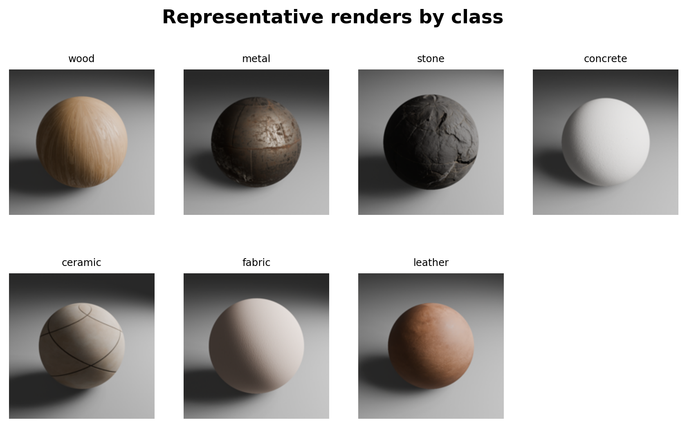
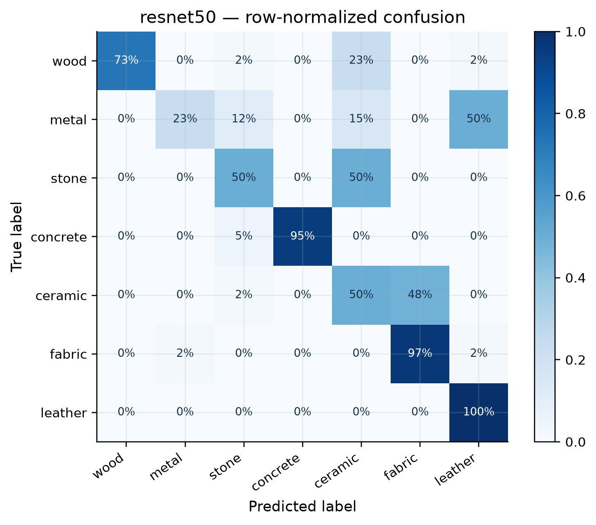
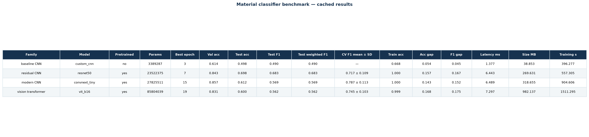
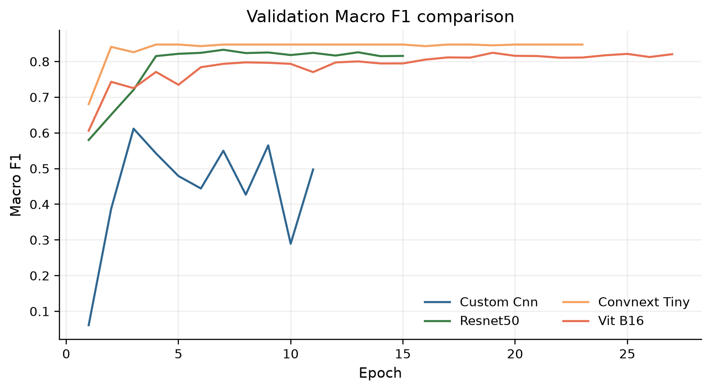

# Blender Material Classification

Leakage-safe classification of seven synthetic PBR material classes rendered in Blender EEVEE. The study compares a small CNN baseline with ImageNet-pretrained ResNet-50, ConvNeXt-Tiny, and ViT-B/16 models.

## Overview and motivation

This design-engineering study tests whether texture, reflectance, and shading cues learned from procedural Blender materials transfer to unseen base materials. The engineering motivation is to measure accuracy, robustness, and inference efficiency before a material recognizer is considered for downstream inspection tooling. Grouping by base-material identity makes the comparison meaningful: near-duplicate renders cannot leak between development and held-out splits.



## Dataset

The dataset contains **3150** RGB PNG renders at 512 x 512, generated with Blender and RenderSynth from **105** independent base materials (30 renders per material). Classes are wood, metal, stone, concrete, ceramic, fabric, and leather. The canonical split is grouped by `material_id`: train 2310 images / 77 materials, validation 420 / 14, and test 420 / 14.

Raw renders and PBR assets remain local. See [DATASET.md](DATASET.md) for regeneration, provenance, licensing notes, and placement instructions. For an existing checkout, place files exactly as `dataset/train/{class}/*.png`, `dataset/val/{class}/*.png`, and `dataset/test/{class}/*.png`; place source PBR material folders at `materials/{class}/{material_id}/`. Run `python scripts/verify_dataset.py` before training.

Classes: `wood`, `metal`, `stone`, `concrete`, `ceramic`, `fabric`, `leather`.

### Procedural generation pipeline

Blender builds the scene and EEVEE render settings; RenderSynth assigns each PBR texture set to a base material; deterministic camera/light variations produce 30 renders per material; manifest validation records class, `material_id`, and split. The generation seed is 62642. Place local data at `dataset/{train,val,test}/{class}/*.png` and source textures at `materials/{class}/{material_id}/`; raw data is intentionally gitignored.

## Method

All models use 224 x 224 inputs, ImageNet normalization, conservative training augmentation, AdamW, label smoothing, warmup/cosine scheduling, AMP, and best-validation-macro-F1 checkpointing. Grouped five-fold `StratifiedGroupKFold` uses development data only; the locked test split is evaluated once after methodology lock.

Compared architectures are intentionally distinct: a from-scratch CustomCNN baseline (capacity floor), ImageNet-pretrained ResNet-50 (residual CNN), ConvNeXt-Tiny (modern convolutional design), and ViT-B/16 (patch-token transformer). Transfer models train a frozen head stage followed by whole-model fine-tuning; all runs use the fixed 40-epoch ceiling and early stopping (patience 8). The baseline is not assigned a fabricated CV score: its table entry is `N/A (not run)`.

Training histories, TensorBoard logs, best/last checkpoints, effective batch sizes, runtime, peak VRAM, environment metadata, and configuration hashes are retained under `artifacts/checkpoints/` and `reports/results/`. Five-fold grouped CV is reported as mean +/- sample SD for the three transfer models; it is computed only on the development materials.

## Results

Completed locked TEST evaluation.

| Model | Family | Pretrained | Best epoch | Test accuracy | Test macro F1 | Test weighted F1 | CV macro F1 (mean +/- SD) |
|---|---|---:|---:|---:|---:|---:|---:|
| CustomCNN | Baseline CNN | no | 3 | 0.498 | 0.490 | 0.490 | N/A (not run) |
| ResNet-50 | Residual CNN | yes | 7 | 0.698 | 0.683 | 0.683 | 0.717 +/- 0.109 |
| ConvNeXt-Tiny | Modern CNN | yes | 15 | 0.612 | 0.569 | 0.569 | 0.787 +/- 0.113 |
| ViT-B/16 | Vision transformer | yes | 19 | 0.600 | 0.562 | 0.562 | 0.745 +/- 0.103 |

The canonical recommendation is **ResNet-50**: TEST Macro F1 0.683, accuracy 0.698, and grouped-CV Macro F1 0.717 +/- 0.109.

The machine-readable source is [reports/results/model_comparison.csv](reports/results/model_comparison.csv), generated from cached artifacts. The recommendation is read from [reports/results/recommended_model.json](reports/results/recommended_model.json) and is not inferred in this document. Supporting tables and figures are under `reports/results/` and `reports/figures/`; see the [report asset index](reports/REPORT_ASSETS.md) for figure links and recommended report usage.







## Project deliverables

- [Illustrated report PDF](report.pdf) and [editable report DOCX](report.docx) — fill in the DOCX cover placeholders for group members, student numbers and submission date, refresh the contents if needed, then re-export the final PDF before submitting.
- [Report asset index](reports/REPORT_ASSETS.md) — publication-ready figures and recommended usage.
- [Model card](MODEL_CARD.md) — intended use, limitations and artifact-backed performance.
- [Kaggle release guide](kaggle.md) — proposed procedure only; Kaggle publication remains conditional on completing the per-asset licensing and attribution audit.
- [Version-2 Optuna plan](reports/OPTUNA_V2_PLAN.md) — development-only improvement proposal that preserves the sealed TEST protocol.
- [Version-2 implementation plan](reports/V2_IMPLEMENTATION_PLAN.md) — implementation-ready Poly Haven provenance, new-holdout, Optuna, validation, and report-integration specification.

## Repository structure

```text
src/material_classifier/   reusable data, models, training, metrics, and plotting code
configs/                   fixed data and model configurations
scripts/                   verification, training, CV, evaluation, reporting, and docs
metadata/                  manifests and split definitions
reports/results/           cached metrics, predictions, embeddings, and tables
reports/figures/           publication-ready figures and galleries
notebooks/                 executed EDA, results, comparison, and error-analysis views
```

## Setup and reproducibility

Use Python 3.13 with the pinned environment. From the repository root run `uv sync --extra dev --extra explainability --extra embeddings --extra reports` (or install the pinned base, development, explainability, embeddings, and reports requirement sets), then verify CUDA/GPU details with `python scripts/collect_environment.py`. The project seed is 42; configs, environment metadata, hashes, histories, and timestamps are recorded under `reports/results/` and `artifacts/checkpoints/`.

## Reproduce

```powershell
uv sync --extra dev --extra explainability --extra embeddings --extra reports
python scripts/verify_dataset.py
python scripts/train_all.py
python scripts/run_group_cv.py --folds 5
python scripts/lock_methodology.py
python scripts/evaluate_all.py --split test
python scripts/generate_report.py
python scripts/generate_visuals.py --explainability
python scripts/update_docs.py
```

Run notebooks from the repository root after artifacts are available: `jupyter lab notebooks/`. Notebooks 02-04 read histories, metrics, predictions, embeddings, and figures; they never train or evaluate models. The `--split test` command is allowed only after the methodology lock; its hashed completion markers make subsequent calls reuse the sealed TEST artifacts. Do not tune after TEST evaluation.

## Limitations

This is a synthetic Blender-render study. Synthetic-to-real generalisation has not been established, and the model should not be treated as a validated arbitrary real-world material recogniser.

## Future work

Synthetic-to-real evaluation, Hugging Face deployment, an interactive web demo, and a potential Kaggle dataset release remain future work. See [kaggle.md](kaggle.md) for the conditional release procedure; publication is not implied and remains blocked until the per-asset licensing and attribution audit is complete.

See [MODEL_CARD.md](MODEL_CARD.md) for intended and inappropriate uses.
