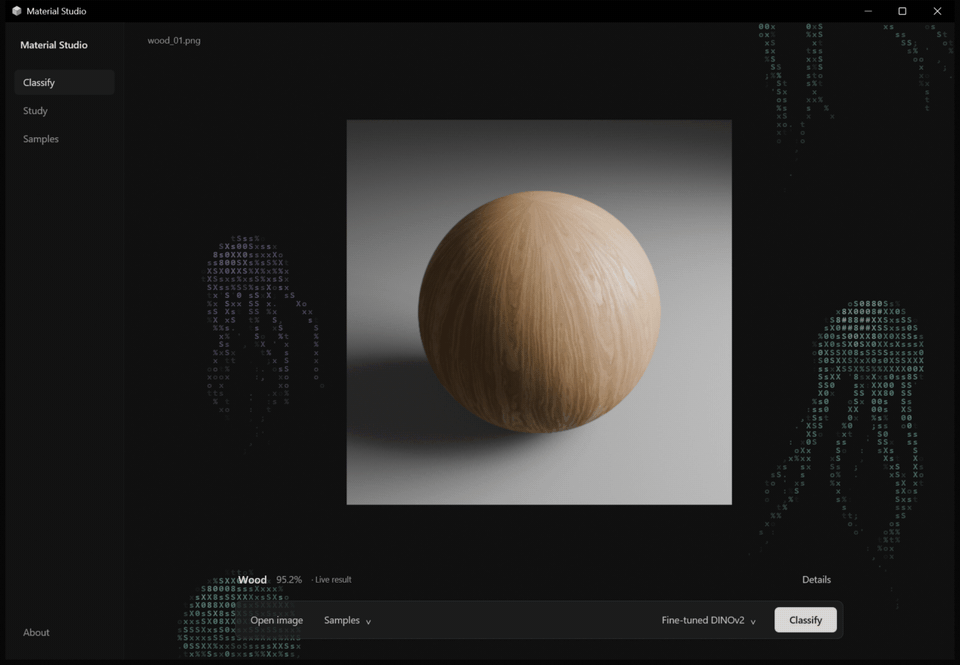

# Material Studio

A native Windows app for exploring material recognition. Classify images locally,
compare four trained models, and inspect measured results in a focused desktop
interface built with Rust GPUI and PyTorch.

**Wood · Metal · Stone · Concrete · Ceramic · Fabric · Leather**



## Install

[Download Material Studio v0.6 for Windows](https://github.com/dianbrown/blender-material-classification/releases/tag/v0.6).
Save **all three files** in the same folder, keeping their names unchanged:

- `MaterialStudio-0.6.0-windows-x64-Setup.exe`
- `MaterialStudio-0.6.0-windows-x64-Setup-1.bin`
- `MaterialStudio-0.6.0-windows-x64-Setup-2.bin`

Run the EXE, then launch Material Studio from the Start Menu. The installer
includes **four trained models, 21 sample images, and the Python runtime**.
Installation and inference work offline once the files are downloaded; no
separate Python installation, model download, or server is needed.

Requires **Windows 10 version 1903 or later, or Windows 11, on x64 Intel/AMD**,
a DirectX 11 capable graphics adapter, and space for approximately **4.8 GiB** of
installed files plus downloads and temporary files. Inference uses a compatible
NVIDIA GPU when available and otherwise runs on the CPU. See the
[installation guide](docs/INSTALLATION.md) for checksums, the unsigned-installer
notice, and removal instructions.

## Use

1. Choose a bundled sample or open a PNG, JPEG, WebP, BMP, or TIFF image.
2. Select a model and click **Classify**. The first prediction loads the model;
   later predictions reuse it.
3. Read the predicted material and confidence. Open **Details** for the full
   probability distribution.
4. Explore **Study** for saved evaluation results and confusion matrices,
   **Samples** for examples, and **About** for project information.

The app defaults to fine-tuned DINOv2. The frozen DINOv2 + ConvNeXt fusion remains
the preselected primary model for evaluation. Live classification uses your
chosen model; the Study view displays stored results. Confidence values are
model probabilities, not guarantees of correctness.

## Measured performance

All four models were evaluated on the same **630 held-out Blender renders from
21 new source groups**, with 90 images and three source groups per material label.

| Model | Accuracy | Macro F1 |
| --- | ---: | ---: |
| Frozen DINOv2 + ConvNeXt fusion (primary) | 80.16% | 0.7952 |
| Frozen ConvNeXt (control) | 75.56% | 0.7566 |
| ResNet-50 (comparison) | 77.62% | 0.7665 |
| Fine-tuned DINOv2 (exploratory comparison) | 86.83% | 0.8631 |

The primary met the 80% point-accuracy target, but its 95% source-group bootstrap
interval is **66.03–93.65%**. Fine-tuned DINOv2 has the highest observed accuracy,
with an interval of **76.98–95.87%**; the paired difference interval includes zero,
so these results do not establish superiority. Thirty views of a source are
correlated, and only three test sources per label limit generalization.

These results describe synthetic material appearances, not physical composition
or validated performance on arbitrary photographs. Compression is a substantial
limitation: JPEG quality 30 lowers accuracy to **59.05%** for fusion and **75.40%**
for fine-tuned DINOv2. The [model card](MODEL_CARD.md) documents selection,
uncertainty, calibration, robustness, and measured inference costs.

## Models and data

The trained models are available in the bundled Windows installer. Checkpoint
identities and development paths are documented in [MODEL_CARD.md](MODEL_CARD.md).

The dataset contains **3,780 renders**: 3,150 development images from 101 known
source groups and 630 test images from 21 new groups. The full dataset is **not
published; a Kaggle release is planned**. The installer includes only the sample
gallery. See [DATASET.md](DATASET.md) for provenance, grouping, rendering details,
and licensing status. The [Kaggle guide](kaggle.md) covers preparing and
publishing the dataset.

## Development

The recorded ML environment uses Windows, Python 3.13.5, and PyTorch 2.11 with
CUDA 12.8. Install `uv` before running the setup script; it requires an available
CUDA device. Use [requirements-v3-lock.txt](requirements-v3-lock.txt) for this
environment rather than the legacy pins in `pyproject.toml`.

The native app requires the Rust toolchain pinned in
[app/rust-toolchain.toml](app/rust-toolchain.toml), Microsoft C++ Build Tools,
and the Windows SDK.

```powershell
./scripts/setup_v3.ps1
./.venv/Scripts/Activate.ps1
./scripts/demo/build_app.ps1
```

A Git checkout contains source and evaluation records; model checkpoints, full
datasets, and pretrained caches are separate resources. Building the executable
alone does not assemble its inference runtime. See the
[packaging guide](docs/DEMO_PACKAGING.md) for required inputs and runtime layout.

The [results notebook](notebooks/05_v3_results.ipynb) presents saved evaluation
evidence. Raw [test outputs](reports/results/v3/fresh), the
[model choice](reports/results/v3/model_choice.json), and the
[checkpoint lock](reports/results/v3/final_model_lock.json) preserve the recorded
selection and evaluation. Training and evaluation code lives in `scripts/v3`
and `src/material_classifier/v3`; the native UI is in `app` and local inference
in `src/material_classifier/demo`.
