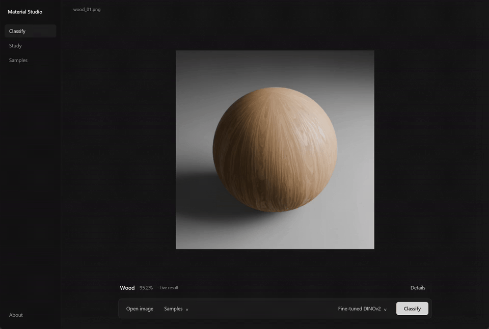

# Material Studio

A native desktop demonstration of material classification, built with Rust GPUI
and local PyTorch inference. Explore seven material classes, classify an image,
and compare the models using the project's measured results.

**Wood · Metal · Stone · Concrete · Ceramic · Fabric · Leather**

## Classroom demo

[Download the v0.5 Windows installer](https://github.com/dianbrown/blender-material-classification/releases/tag/v0.5).
Download **Setup.exe and both Setup-1.bin / Setup-2.bin files** into the same
folder, then run Setup.exe. Keep all three filenames unchanged.
It installs Material Studio for your Windows account and creates a Start Menu
shortcut. All **four trained models**, **21 sample images** and the Python
runtime are included; no separate Python setup, model download or server is
needed. Installed files use approximately **4.8 GiB**.

The installer targets **64-bit Windows 10 (1903 or later) and Windows 11**.
Compatible NVIDIA GPUs use CUDA; otherwise inference uses the CPU. The first
prediction loads the selected model, then later predictions reuse it.
See [installation and removal instructions](docs/INSTALLATION.md), including
release-file checksums and the unsigned-installer notice.

For a locally built portable copy, open `MaterialStudio.exe` inside the complete
package folder and keep that folder together. Packaged CPU and CUDA inference
have been verified; the application also runs outside the development checkout.

The neutral Acrylic background is gently translucent, with crisp foreground
content. The minimal interface has four views: **Classify / Study / Samples /
About**. Classify shows one image with a compact bottom toolbar: **Open image**,
**Samples**, the **model menu**, then **Classify**.

1. Pick a sample or open a PNG, JPEG, WebP, BMP or TIFF image.
2. Select a model and click **Classify**. The first prediction loads that model;
   subsequent predictions reuse it.
3. Read the predicted class and confidence. Open the optional **Details** panel
   for the full probability distribution. Classification runs the selected model
   on the image; the Study view displays stored experimental results.
4. Open **Study** for the held-out model comparison and confusion matrices,
   **Samples** to browse examples, or **About** for project information.

The interface defaults to fine-tuned DINOv2, provisionally recommended for
classroom demonstrations with comparable renders because of its observed
accuracy and lower batch-one latency than fusion. Fusion remains the preselected
study primary. This recommendation does not establish statistical superiority.
Class probabilities are not guarantees; arbitrary photographs have not been
validated.



A recording of live classification, study results and samples; pauses shortened.
[Download the MP4](https://github.com/dianbrown/blender-material-classification/releases/download/v0.5/material-studio-loop.mp4).

## Project submission

- [Project report (PDF, 19 pages; 14 main pages)](reports/project/report.pdf)
- [Editable report](reports/project/report.md)
- [Presentation (14 slides)](reports/presentation/material_classification.pptx)
  and [slide PDF](reports/presentation/material_classification.pdf)
- [Classroom demonstration guide](docs/CLASSROOM_DEMO.md)
- [Executed results notebook](notebooks/05_v3_results.ipynb)
- [Dataset description](DATASET.md) and [model details](MODEL_CARD.md)

The report follows the ITRI626 project structure. Group-member and student-number
fields are intentionally blank at the user's request. The report and slides
and the verified classroom application are ready for rehearsal.

## Measured results

All four pipelines were evaluated on the same **630 held-out renders from 21 new
source groups**. Each of the seven classes contributes 90 images.

| Model | Accuracy | Macro F1 |
| --- | ---: | ---: |
| Frozen DINOv2 + ConvNeXt fusion | 80.16% | 0.7952 |
| Frozen ConvNeXt control | 75.56% | 0.7566 |
| ResNet-50 | 77.62% | 0.7665 |
| Fine-tuned DINOv2 | 86.83% | 0.8631 |

The fusion pipeline was selected before the test and met the 80% point-accuracy
target. Fine-tuned DINOv2 is an exploratory comparison. Their accuracy 95%
source-group bootstrap intervals are **66.03–93.65%** and **76.98–95.87%**;
the paired difference interval includes zero. The study therefore does not
establish that one model is superior across the wider material population.

Compression is a meaningful limitation: JPEG quality 30 reduces fusion accuracy
to **59.05%** and fine-tuned DINOv2 accuracy to **75.40%**. The report includes
per-class results, confidence intervals, confusion matrices, recorded learning
curves, error examples and measured deployment costs. Calibration analysis is
available in the results notebook and model card.

## Dataset and method

The project contains **3,780 Blender renders**, with 30 views per material:

| Partition | Images | Material IDs | Known source groups |
| --- | ---: | ---: | ---: |
| Development | 3,150 | 105 | 101 |
| Held-out test | 630 | 21 | 21 |

PBR materials are attributed to [Poly Haven](https://polyhaven.com/textures) and
[ambientCG](https://ambientcg.com/), which distribute the source assets under
CC0. The project creates the rendered image dataset; it does not claim authorship
of those third-party texture maps. Provenance, class definitions and licensing
details are documented in [DATASET.md](DATASET.md).

Related source materials remain in the same group. Five outer and three inner
development folds evaluate frozen-feature model selection; ResNet uses a fixed
training schedule, and DINOv2 uses a bounded partial fine-tuning experiment.
Final models are fixed before test prediction. Thirty views of one source are
correlated, so uncertainty is resampled over sources rather than individual images.

The test collection has only three source groups per class, restricted definitions
for some classes and a documented rendering-domain difference. No arbitrary
real-world image performance is claimed. The test set has now been evaluated;
future tuning on it requires disclosure and a new independent assessment.

## Development setup

The recorded environment uses Windows, Python 3.13.5, PyTorch 2.11 with CUDA 12.8,
and an RTX 4070 Laptop GPU. Rust GPUI uses its pinned toolchain and dependency
revision. Building the native executable also requires the Microsoft C++ build
tools and Windows SDK. Use [requirements-v3-lock.txt](requirements-v3-lock.txt)
for the recorded ML environment; the legacy dependency pins in `pyproject.toml`
do not describe this environment. The setup script requires `uv` and checks CUDA.

```powershell
# Prepare the recorded ML environment (requires uv).
./scripts/setup_v3.ps1
./.venv/Scripts/Activate.ps1

# Optional notebook tooling, without changing the ML dependency versions.
python -m pip install -c requirements-v3-lock.txt -r requirements-notebook.txt

# Build the native application with the project-pinned Rust toolchain.
./scripts/demo/build_app.ps1
```

Model weights, full datasets and pretrained caches are local resources rather
than Git files. Their paths and expected identities are in
[MODEL_CARD.md](MODEL_CARD.md). There is no public weight or dataset download
URL yet. Dataset submission to Kaggle remains with the project owner.

For portable assembly and runtime requirements, see
[packaging instructions](docs/DEMO_PACKAGING.md), using
`dist/MaterialStudio-release` as the final output directory. The packaged GPU
runtime is larger than the native UI executable; it includes the actual
inference libraries and required weights.

## Reproduce and inspect

The visible-output notebook reads saved evidence and checks its consistency
without retraining models or rescoring the test set:

```powershell
python scripts/v3/build_results_notebook.py --root . --output notebooks/results_rebuilt.ipynb --execute
python -m pytest -q
```

Training, grouped fold assignments, evaluation scripts and the measured results
are retained under `scripts/v3`, `src/material_classifier/v3`, `metadata/v3` and
`reports/results/v3`. The [model choice](reports/results/v3/model_choice.json),
[checkpoint lock](reports/results/v3/final_model_lock.json) and
[saved test outputs](reports/results/v3/fresh) preserve the evaluation evidence.

The native frontend is under `app`; the persistent local inference service is
under `src/material_classifier/demo`. UI rendering stays separate from model
loading and inference. Live-image inference preserves the reviewed preprocessing
and saved model weights.

## Attribution

The interface uses [GPUI](https://www.gpui.rs/) from the Zed project. Model work
builds on DINOv2, ConvNeXt and ResNet, with references in the project report and
model card. The portable package includes dependency notices. The rendered
dataset has no assigned licence or public download; Kaggle publication remains
the owner's decision, and nothing has been uploaded.
