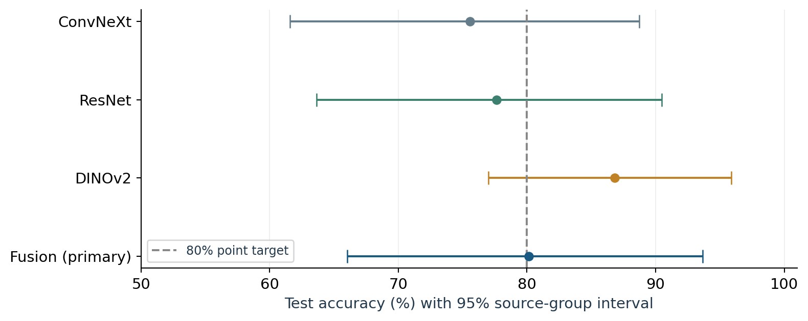
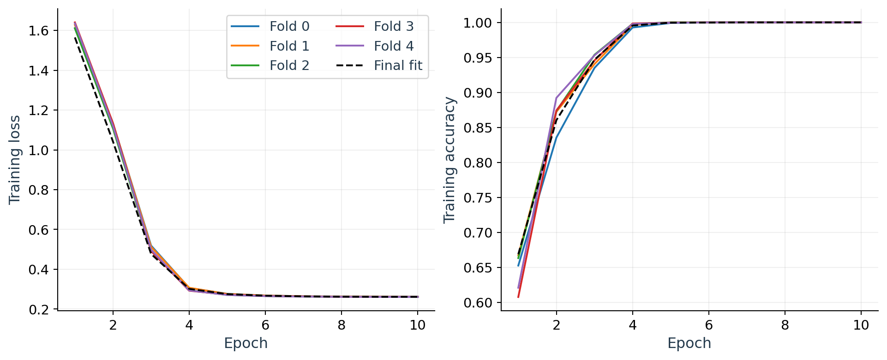
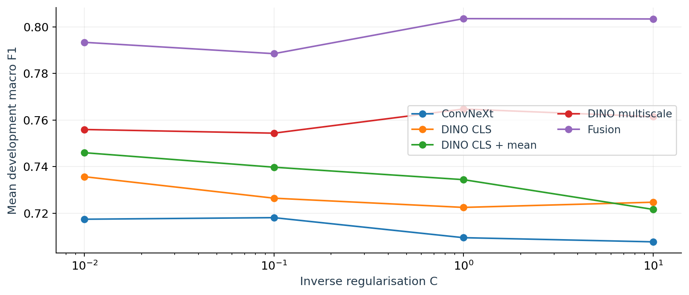
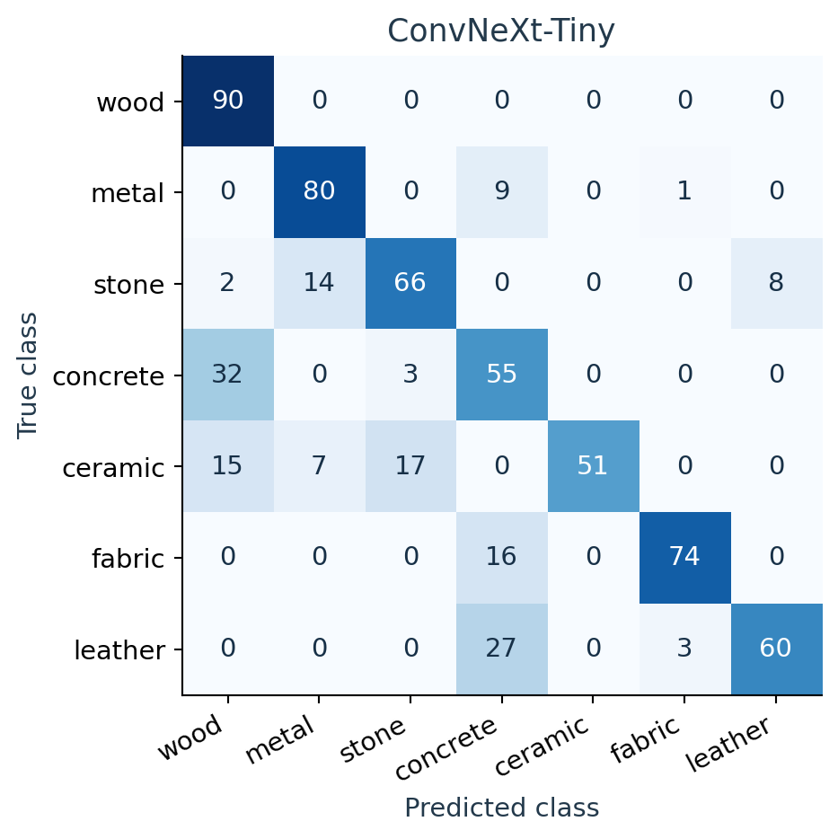
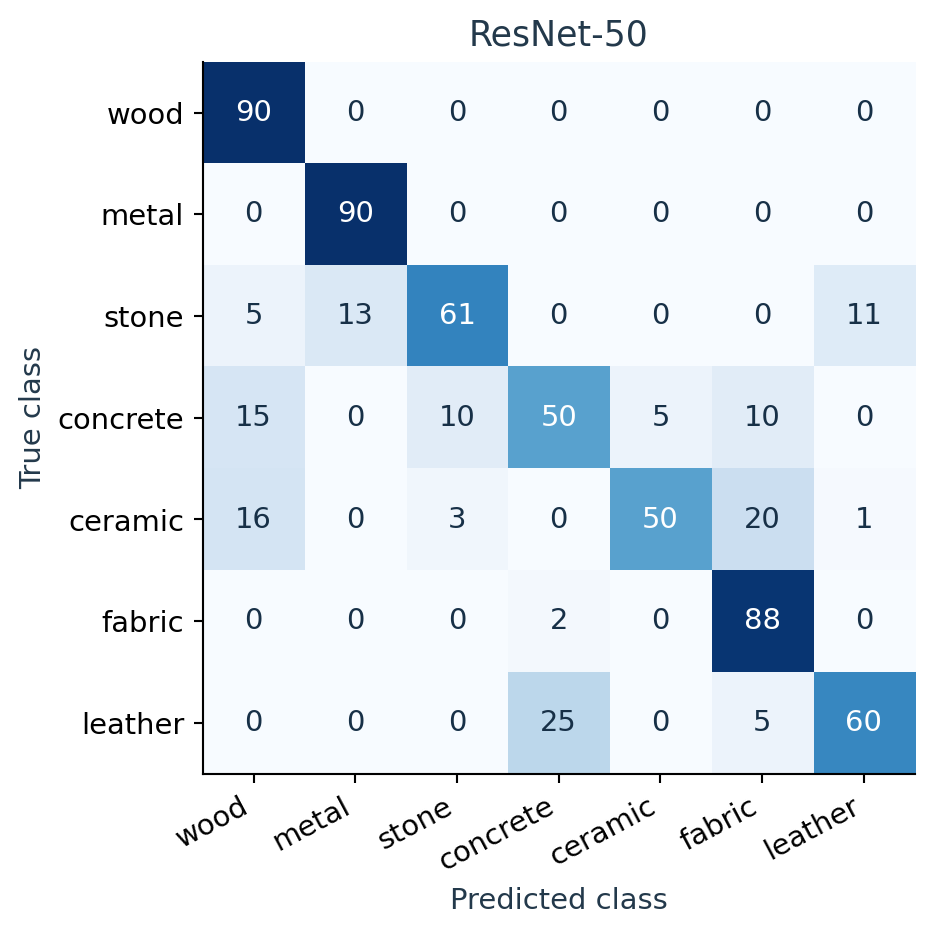
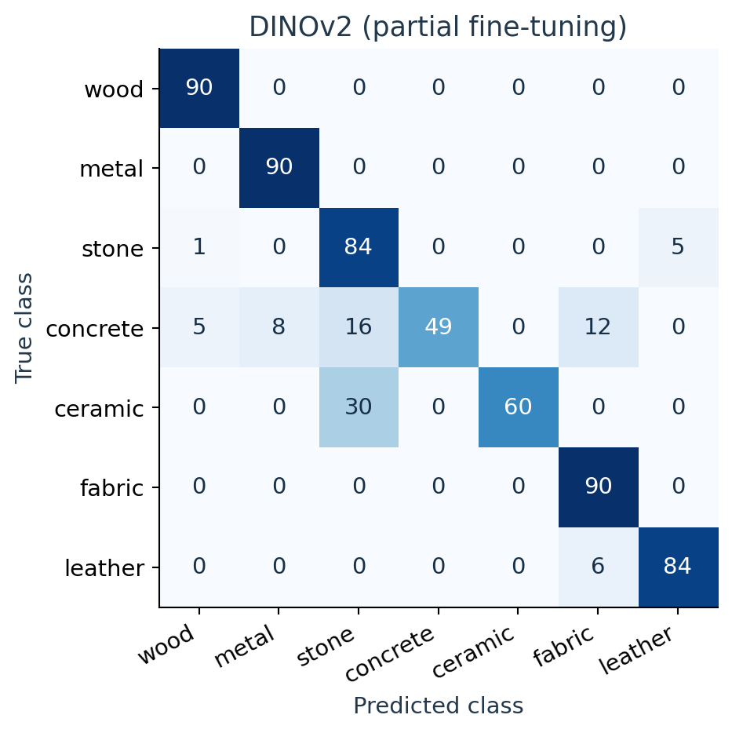
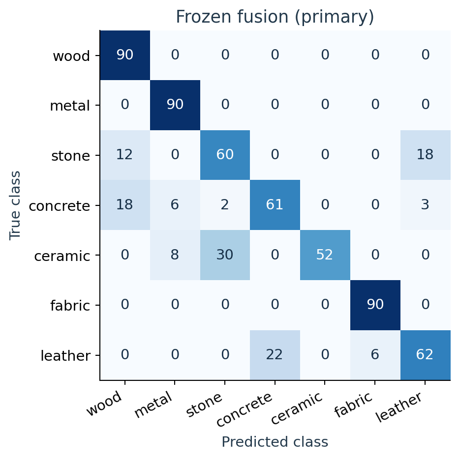

# Recognising material appearance in Blender renders

ITRI626 practical project | Deep learning for image classification

Group member: ____________________  Student number: ______________

Group member: ____________________  Student number: ______________

Group member: ____________________  Student number: ______________

## Abstract

This project compares transfer learning approaches for classifying rendered surfaces as wood, metal, stone, concrete, ceramic, fabric or leather. The dataset contains 3,150 development images from 101 known source families and a separate test set of 630 images from 21 additional families. Grouped development splits keep related material views together. The three main architectural families are ConvNeXt, ResNet and DINOv2; a frozen DINOv2-ConvNeXt fusion is included as an extension and was selected as the primary model before test prediction.

The primary fusion achieves 80.16% test accuracy (95% source-group bootstrap interval 66.03-93.65%) and macro F1 of 0.7952. Partially fine-tuned DINOv2 has the highest observed comparison accuracy, 86.83% (76.98-95.87%), and macro F1 of 0.8631. ConvNeXt and ResNet achieve 75.56% and 77.62%, respectively. DINOv2 also has lower measured batch-one latency than fusion, making it a provisional choice for a classroom demonstration. This recommendation follows the observed test comparison and does not change the predeclared primary or establish statistical superiority.

Errors concentrate in visually overlapping categories, including ceramic, stone and concrete. Compression reduces performance substantially. The results support classification of comparable synthetic renders, while the small number of independent source families, unequal model budgets and absence of real-photograph evaluation limit broader conclusions.

Keywords: material appearance; transfer learning; synthetic images; grouped evaluation; image classification.

<!-- pagebreak -->

# 1. Introduction and problem motivation

Material appearance influences how digital assets are searched, organised and reviewed. A material classifier could help sort a collection of rendered surfaces or flag assets whose visual category differs from their catalogue label. This is useful in a graphics workflow, but it is a narrower problem than identifying physical composition: a painted surface can resemble another substance, and an image alone does not establish its underlying material.

The task is single-label, seven-class classification. Each input is one RGB render of a sphere carrying a physically based rendering (PBR) texture. The model must assign one of wood, metal, stone, concrete, ceramic, fabric or leather. These familiar categories span grain, weave, pores, reflective surfaces and mineral textures, providing meaningful visual differences while retaining difficult boundaries.

The central question is whether pretrained representations can recognise these categories on source materials excluded from development. An engineering target of 80% image-level test accuracy provides a concrete reference. It is a point-estimate target, not a guarantee for every source or a required lower confidence limit.

## Architectural motivation

ConvNeXt modernises a convolutional architecture [1], ResNet uses residual connections [2], and DINOv2 supplies self-supervised transformer features [3]. Register tokens are an additional feature of the chosen DINOv2 implementation [4]. The three families offer different representations and transfer learning strategies. The fusion extension combines convolutional and transformer descriptors; it is not counted as a fourth independent model family.

A small rendered dataset is well suited to transfer learning because the available source variety is limited. The study therefore compares training a classifier over fixed pretrained features with adapting a limited portion of a pretrained network. It does not attempt to train a large backbone from scratch.

## Evaluation rationale

Each material contributes 30 views under controlled rendering variation. These views share texture content, so random image splitting would allow closely related examples to appear in training and evaluation. Splitting by source family instead tests generalisation to held-out sources. Grouped model selection also separates fitting decisions from evaluation, reducing the selection bias described by Cawley and Talbot [5].

The contribution is a comparison of complete, trained pipelines on the same test population, supported by recorded learning histories, class-level analysis and examples of both correct and incorrect predictions. Differences in pretraining, resolution and adaptation budget are reported explicitly.

<!-- pagebreak -->

# 2. Dataset source, classes and preparation

The images were generated with Blender EEVEE from public PBR assets. The source catalogues are Poly Haven (https://polyhaven.com/textures) and ambientCG (https://ambientcg.com/). The development collection uses 96 Poly Haven and nine ambientCG material sources; the test collection adds 21 source groups. Source registries retain the individual asset URLs and their assigned labels. Provider assets are distributed under CC0 [6,7].

All renders are 512 x 512 RGB images. There are 105 development material IDs and 21 test IDs, with 30 views per ID. Related development assets are merged into 101 known families; the test set contains 21 additional families. Camera and lighting variation create different views of the same textured object, rather than 30 independent materials.

| Class | Dev. before | Dev. after | Test before | Test after | Dev. groups | Test groups |
| --- | --- | --- | --- | --- | --- | --- |
| Wood | 450 | 450 | 90 | 90 | 14 | 3 |
| Metal | 450 | 450 | 90 | 90 | 15 | 3 |
| Stone | 450 | 450 | 90 | 90 | 15 | 3 |
| Concrete | 450 | 450 | 90 | 90 | 15 | 3 |
| Ceramic | 450 | 450 | 90 | 90 | 15 | 3 |
| Fabric | 450 | 450 | 90 | 90 | 15 | 3 |
| Leather | 450 | 450 | 90 | 90 | 12 | 3 |

Table 1. Image counts before and after the recorded integrity checks. Development totals: 3,150 before and after; test totals: 630 before and after. Every class has 540 retained images overall. No removed-image count is inferred from source-selection exclusions.

## Labels and cleaning

Labels were assigned from the source material catalogue and the project's material mapping, then checked for manifest consistency and class-pure source groups. The development audit records 3,150 readable images, no missing images, no corrupt-render integrity errors, no exact duplicate renders or duplicate decoded render pixels, and no cross-class conflicts. All 630 completed test renders passed the model-free integrity check. These checks support retaining the complete collections; no label corrections or image removals are recorded for this analysis.

These are appearance labels, not laboratory ground truth. Wood covers timber and veneer; metal includes weathered or coated metallic surfaces; stone covers rock and mineral surfaces; fabric covers woven textiles; and leather includes leather-like textured surfaces. The broad development ceramic category includes mosaic and terrazzo-like sources, while concrete includes plaster and painted walls. Test ceramic and concrete were selected under narrower definitions. This semantic difference is retained as a limitation rather than hidden through relabelling.

Classes are image-balanced, but source diversity is uneven: leather has 12 known development groups and wood 14, compared with 15 for each other class. Related assets are grouped rather than deleted. No difficult example is excluded because a model predicts it incorrectly.

<!-- pagebreak -->

# 2.1 Dataset examples, source separation and ethics

The known-family registry merges related leather generator outputs and a conservative wood relationship. Test source selection excludes known development identities, aliases, related names, procedural families and exact source-map reuse. All views of a family remain in one partition. This prevents known overlap, although catalogue records cannot prove that all underlying physical captures are independent.

The original corpus had already been used for model development, including consultation of its earlier test subset. Consequently, all 3,150 images are treated as development data. The independently collected 630-image set supplies the common test endpoint. No original image is presented as a newly untouched test example.

The project authors the renders and experimental code, while acknowledging the providers of the texture maps. CC0 source permission and the project's rendered-dataset release status are distinct: a dataset-level licence has not been assigned and public release has not been approved. There is no public rendered-dataset download claimed here.

No people, health records or sensitive personal data are subjects of these renders. The main ethical concerns are accurate attribution, lawful source use and avoiding exaggerated claims about physical identification. The classifier is appropriate for research and teaching with similar renders, not for decisions about material safety or composition.

<!-- pagebreak -->

# 3. Methodology, models and transfer learning

| Pipeline | Pretrained representation | Trained components |
| --- | --- | --- |
| ConvNeXt-Tiny | convnext_tiny.fb_in22k_ft_in1k; ImageNet-22K then ImageNet-1K [8] | Standardised 768-feature logistic classifier; backbone frozen |
| ResNet-50 | Torchvision ResNet50_Weights.IMAGENET1K_V2 [9] | Classifier for two epochs, then layer4 and classifier |
| DINOv2 | vit_small_patch14_reg4_dinov2.lvd142m; ViT-S/14 with four registers [10] | 768-feature head; last two blocks after two head-only epochs |
| Fusion extension | Same frozen DINOv2 plus ConvNeXt weights | 3,072-feature standardised logistic classifier |

Table 2. Three main families and the fusion extension. Every pipeline includes a classifier fitted to the material labels; a frozen backbone does not mean an untrained pipeline.

ConvNeXt uses global pooled features. ResNet replaces the ImageNet classifier with a seven-class head and adapts its final residual stage; batch-normalisation running statistics remain fixed. DINOv2 concatenates the CLS token and mean image-patch token at 336 pixels, adds dropout 0.1 and a linear seven-class head, and adapts its final two transformer blocks, final normalisation and head. Register tokens are excluded from patch pooling.

The fusion descriptor concatenates DINOv2 CLS, patch mean and patch population standard deviation at 224 and 336 pixels, followed by 768 ConvNeXt features at 224 pixels: 2 x (3 x 384) + 768 = 3,072 features. A training-partition StandardScaler and L2 logistic regression produce seven-class probabilities. This tests whether complementary descriptors help in a small-data setting.

## Selection and primary status

The frozen selection plan compares five representations: DINOv2 CLS at 224; CLS plus patch mean at 224; multiscale CLS, mean and standard deviation; ConvNeXt pooled features; and multiscale fusion. Each is tested with C in {0.01, 0.1, 1, 10}. Selection maximises mean grouped validation macro F1, breaking ties by declared candidate order and then ascending C. The ConvNeXt control selects C independently on the same partitions.

ResNet follows a predeclared fixed schedule. Partial DINOv2 fine-tuning is an exploratory development follow-up prompted by the frozen model's development result. Its two learning rates and epoch choices use the same three development selection folds, so its best-fold scores are adaptive selection scores, not an unbiased nested estimate.

Development selection favoured frozen fusion (macro F1 0.80352) over adapted DINOv2 (0.77248). Fusion therefore remained primary. All four final models were fixed before any test prediction. The higher observed DINOv2 test score is reported as a comparison without retrospectively replacing the primary.

<!-- pagebreak -->

# 4. Experimental setup and hyperparameters

## Grouped splits and random seeds

The outer split seed is 20261027; inner seeds add outer_fold + 1, and final selection uses 20262027. Class-stratified folds are formed over sorted unique source groups, then expanded to image rows. Frozen selection uses five outer folds and three inner folds. ResNet uses exactly the same five outer folds. The final three-fold selection plan is shared by the frozen heads and exploratory DINOv2 tuning. Table 3 gives exact persisted counts; Appendix C includes class distributions and the nested inner partitions.

| Partition | Train images | Valid. images | Train groups | Valid. groups |
| --- | --- | --- | --- | --- |
| Outer 0 | 2460 | 690 | 80 | 21 |
| Outer 1 | 2520 | 630 | 81 | 20 |
| Outer 2 | 2550 | 600 | 81 | 20 |
| Outer 3 | 2520 | 630 | 81 | 20 |
| Outer 4 | 2550 | 600 | 81 | 20 |
| Selection 0 | 2040 | 1110 | 67 | 34 |
| Selection 1 | 2100 | 1050 | 67 | 34 |
| Selection 2 | 2160 | 990 | 68 | 33 |
| Final fit / test | 3150 | 630 | 101 | 21 |

Table 3. The final row pairs all-development fitting with the independent test set, not another validation fold. Test support is 90 images and three groups in every class. Folds are alternatives, not disjoint datasets to be added together.

All final models are fitted on the same 3,150 development images and evaluated on exactly the same 630 test images. Training and validation allocation during tuning differs by design: DINOv2 uses the three selection folds, whereas ResNet's fixed baseline uses the five outer folds. Thus the common final test split is matched, but tuning budgets and validation procedures are not identical.

## Preprocessing and augmentation

All inputs are EXIF-oriented RGB, converted to float32 in [0,1], then normalised by mean (0.485, 0.456, 0.406) and standard deviation (0.229, 0.224, 0.225). Frozen ConvNeXt resizes the shorter edge to 256 with PIL bicubic interpolation and takes a rounded 224 centre crop. Frozen DINOv2 resizes the shorter edge to 224 or 336 and centre-crops to that size; crop percentage is 1.0. Frozen extraction uses no stochastic augmentation or foreground masking.

ResNet evaluation uses a bilinear antialiased shorter-edge resize to 232 and a 224 centre crop. Adapted DINOv2 evaluation uses the deterministic bicubic 336 transform above. Only neural training uses random resized crops (scale 0.88-1.00; aspect ratio 0.95-1.05; bilinear, antialiased), horizontal flip probability 0.5, and colour jitter (brightness 0.10, contrast 0.10, saturation 0.05, hue 0.02). Outputs are 224 for ResNet and 336 for DINOv2. Mild crop, orientation and illumination changes are plausible for rendered textures; no MixUp or CutMix is used.

<!-- pagebreak -->

# 4.1 Optimisation and computing environment

| Setting | Frozen ConvNeXt / fusion | ResNet-50 | Adapted DINOv2 |
| --- | --- | --- | --- |
| Optimiser | L-BFGS logistic regression | AdamW | AdamW |
| Learning rate | No epoch learning rate; search C | Head 3e-4; layer4 1e-5 | Head 3e-4; backbone 3e-6 or 1e-5 |
| Schedule | Not applicable | 10-epoch cosine to zero; no reset | Constant |
| Regularisation | L2; C grid; balanced class weights | Weight decay 0.01 | Weight decay 0.01; none on bias/norm |
| Loss | Multinomial logistic loss | Cross entropy; smoothing 0.05 | Cross entropy; smoothing 0.05 |
| Batch / accumulation | Extraction 16; full-partition head fit | 16 x 2 = 32 effective | 8 x 4 = 32 effective |
| Epochs / stopping | Max 3,000 solver iterations; tol 1e-4 | 10 fixed; no early stopping | Up to 10; patience 3; final fit 5 |
| Class weighting | n / (7 x class count) | None; per-image mean | None; per-image mean |

Table 4. Optimisation settings. C is inverse logistic regularisation strength, not a neural learning rate. All-development selection chooses C=0.1 for ConvNeXt and C=1 for fusion. Neural batches retain partial final updates and normalise gradients by their actual image counts.

Both neural optimisers use betas (0.9, 0.999), epsilon 1e-8, gradient-norm clipping at 1.0 and CUDA float16 automatic mixed precision with gradient scaling. ResNet trains its head for epochs 1-2, then layer4 and head through epoch 10. DINOv2 likewise starts with two head-only epochs. At the selected backbone rate 1e-5, the best development epochs are 6, 5 and 3; the rounded median gives the fixed five-epoch full-data fit. Validation patience applies only to selection fits.

The base seed is 20261027. ResNet epoch seeds add outer_fold x 1000 and the zero-based epoch; the full fit uses base + 100000 + epoch. DINOv2 fit seeds add fold x 10000, or 900000 for the full fit, followed by the recorded epoch offset. Data loaders use seeded generators and zero workers. Rendering uses seed 62642. Full-data class balance makes each logistic class weight equal to one, while fold-specific weights address unequal image counts within grouped partitions.

Experiments ran on an NVIDIA GeForce RTX 4070 Laptop GPU with 8,585,216,000 bytes of reported device memory (about 8 GiB). The recorded stack is Python 3.13.5, PyTorch 2.11.0+cu128, Torchvision 0.26.0+cu128, timm 1.0.30, CUDA runtime 12.8, NumPy 2.5.2, scikit-learn 1.9.1, SciPy 1.18.1 and Pillow 12.3.0. Model implementations and transforms follow timm and Torchvision [8-10]; the fitted scaler and logistic classifier use scikit-learn [11].

The test renderer is Blender 5.1.1. The original renderer version is incompletely recorded; a development-image pilot matched framing and placement but had softer ground shadows. Hardware and software records permit contextual reproduction, while exact visual equivalence across renderer versions is not established.

<!-- pagebreak -->

# 5. Results and model comparison

| Pipeline | Accuracy | 95% accuracy CI | Macro P | Macro R | Macro F1 |
| --- | --- | --- | --- | --- | --- |
| ConvNeXt-Tiny | 75.56% | 61.59%-88.73% | 0.7932 | 0.7556 | 0.7566 |
| ResNet-50 | 77.62% | 63.65%-90.48% | 0.7885 | 0.7762 | 0.7665 |
| DINOv2 (partial fine-tuning) | 86.83% | 76.98%-95.87% | 0.8970 | 0.8683 | 0.8631 |
| Frozen fusion (primary) | 80.16% | 66.03%-93.65% | 0.8124 | 0.8016 | 0.7952 |

Table 5. Saved clean test results for the same 630 images and 21 source groups. P and R denote precision and recall. Every class has equal support. Full per-class precision, recall and F1 appear in Appendix A, and all four confusion matrices in Appendix B.

Fusion classifies 505 of 630 images correctly, meeting the 80% point target at 80.16%. Adapted DINOv2 classifies 547 correctly and obtains the highest observed accuracy and macro F1. ConvNeXt has 476 correct predictions and ResNet 489. These are pipeline comparisons: changes in pretraining, input size and adaptation accompany the architectural differences.

Intervals use the saved 10,000-draw, class-stratified source-group bootstrap (seed 62642). A sampled group carries all its views, preserving within-source correlation. The paired DINOv2-minus-fusion accuracy difference is 6.67 percentage points, with a 95% interval of -2.06 to 16.19. This does not establish superiority. These intervals condition on the trained models and saved predictions; they do not include refitting uncertainty.

Development out-of-fold accuracy was 79.40% for the frozen selector, 68.86% for ConvNeXt and 71.56% for ResNet. These estimates concern the development population and selection procedure. They are not pooled with test metrics, and their difference from test performance is not an estimate of improvement over time.

<!-- pagebreak -->

# 5.1 DINOv2 learning behaviour

Training loss decreases and training macro F1 approaches one, while validation varies substantially across source folds. The gap is consistent with fitting a limited and correlated collection more closely than it generalises to unseen source families. The most difficult selection fold remains weaker under both rates.

The mean best validation macro F1 is 0.76250 at 3e-6 and 0.77248 at 1e-5. The larger rate is selected for the final fit. Early stopping shortens the six histories to 6, 6 and 7 epochs at 3e-6, and 9, 8 and 6 at 1e-5. The retained best epochs, rather than the stopping epochs, determine the final five-epoch duration.

These validation curves informed both learning-rate and epoch selection. Their best scores are therefore optimistic development diagnostics. They explain the adaptation process, while the independent test table evaluates the fixed exported model. No learning curve is calculated from the test set.

<!-- pagebreak -->

# 5.2 Fixed ResNet training and frozen-head selection

ResNet records a single final-epoch evaluation for each outer fold. It has no epoch-wise validation loss or validation accuracy/F1 curve. The fixed schedule avoids selecting a checkpoint on outer validation labels, but leaves the assignment's validation-curve requirement incomplete for this model. Training curves and final scores cannot reconstruct the missing history.

The frozen ConvNeXt and fusion backbones have no task-training epochs. Their fitted logistic heads use an iterative convex solver, and the retained diagnostic is validation performance across the C search. No solver-iteration train/validation history was saved. The strongest development choice is multiscale fusion at C=1; the independently selected ConvNeXt control uses C=0.1.

<!-- pagebreak -->

# 6. Discussion, limitations and error analysis

## Where the models fail

For the primary fusion, wood, metal and fabric each have recall 1.000 on the sampled test sources. Ceramic recall is only 0.578 despite precision 1.000: predicted ceramic images are correct, but many actual ceramic views are assigned elsewhere. Stone, concrete and leather recalls are 0.667, 0.678 and 0.689. The complete confusion matrices expose the directions of these errors rather than reducing them to one aggregate score.

Adapted DINOv2 improves observed stone and leather recall to 0.933 each, but concrete recall falls to 0.544 from fusion's 0.678. Thus its better aggregate accuracy does not improve every category. ConvNeXt and ResNet offer useful independent baselines, but neither reaches the 80% point target on this test set.

Plausible ambiguities include similar mineral patterns in ceramic and stone, roughness shared by concrete and rock, and coatings that weaken the visual cues associated with metal or leather. Such explanations describe visible similarities; they are not causal attribution of the network's decision. No saliency experiment here proves which feature caused an error.

<!-- pagebreak -->

# 6.1 Robustness and practical model choice

| Image condition | Fusion accuracy | DINOv2 accuracy |
| --- | --- | --- |
| Brightness x0.6 | 78.25% | 85.24% |
| Brightness x1.4 | 83.02% | 89.05% |
| Gaussian blur, radius 1.5 | 77.14% | 80.00% |
| JPEG quality 30 | 59.05% | 75.40% |
| Resolution 128 x 128 | 75.08% | 83.17% |

Table 6. Saved results under five deterministic corruptions of the same 630 test images. Fusion corruptions were predeclared. DINOv2 corruption evaluation was added after observing clean and primary corruption results and is post hoc exploratory analysis.

JPEG quality 30 causes the largest fusion accuracy loss: 21.11 percentage points, down to 59.05%, with macro F1 0.5749. DINOv2 reaches 75.40% under this compression, below its clean score of 86.83%. Blur, reduced resolution and brightness changes probe image sensitivity; they do not supply new source families or real-camera validation.

| Pipeline | Batch-one median (ms) | Batch-16 images/s | Deployment MB |
| --- | --- | --- | --- |
| Fusion (primary) | 42.876 | 46.361 | 203.63 |
| ConvNeXt | 14.205 | 174.416 | 115.27 |
| ResNet-50 | 9.463 | 294.688 | 95.32 |
| DINOv2 | 13.862 | 101.438 | 88.03 |

Table 7. Existing measurements on the recorded RTX 4070 Laptop GPU, using four CPU threads, five warm-up runs and 30 timed repetitions. Warm timings begin with predecoded RGB and include preprocessing, model computation and probability output. They exclude disk reading, decoding and model loading. Storage includes the required model components; MB means 1,000,000 bytes.

DINOv2 combines the highest observed clean accuracy with a 13.862 ms batch-one median, compared with fusion's 42.876 ms. It is therefore a reasonable provisional choice for a classroom demonstration of similar renders. ResNet is faster at 9.463 ms but less accurate in this comparison. DINOv2's batch-16 throughput is lower than ConvNeXt's and ResNet's, so its speed advantage is specific to the comparison and workload.

This recommendation follows observed test performance and practical cost. It is not a new primary selection, proof of general superiority, or evidence that an application interface has been validated. A demonstration should communicate the appearance-based labels and uncertainty, and avoid presenting arbitrary photographs as a tested use case.

<!-- pagebreak -->

# 6.2 Study limitations and interpretation

## Source diversity and domain shift

Only three test groups per class support the headline scores. Thirty correlated views of one source increase image count without adding equivalent material diversity. Perfect recall for three sampled sources does not imply perfect population recall. Known-family grouping is conservative, but undisclosed captures, recolours or derivatives can still share ancestry. Public texture overlap with the backbone pretraining datasets has not been audited.

The same sphere, scene and renderer constrain variation in object shape and context. Source novelty does not establish generalisation to new geometry, lighting distributions or cameras. Narrower test ceramic/concrete definitions and a renderer-version difference also mean the test collection is not simply a random sample of the original development population.

## Comparison fairness and interpretation

The final development population and test set are shared, and all model configurations are fixed before test prediction. Nevertheless, the pipelines differ in pretrained corpus, training objective, input resolution, number of backbone passes, optimisation and tuning budget. Their comparison measures useful complete systems; it cannot isolate the effect of architecture, self-supervision or fine-tuning alone.

Partial DINOv2 fine-tuning follows the frozen development outcome. Its selection scores are explicitly exploratory. The later DINOv2 corruption analysis is also post hoc. Disclosing these choices prevents adaptive evidence from being presented as one wholly predeclared experiment. The primary fusion result remains the anchor for the original target.

Missing ResNet validation curves limit learning-dynamics analysis and leave a required assessment item incomplete. The frozen heads have no neural epoch curves and no saved per-iteration loss history. These gaps are not remedied by substituting curves from a different model or experiment.

## Priorities for further work

The most useful next dataset would add independently verified sources in ambiguous classes, include held-out scene geometry and genuine photographs, and preserve a new test set before any further tuning. Budget-matched ablations could separate the contribution of resolution, feature fusion and partial adaptation. Compression augmentation and calibrated rejection thresholds should first be selected on development data and then assessed independently.

The present test set is now an observed benchmark. Any subsequent model choices based on it require a new independent assessment for confirmatory claims. These limits do not erase the measured performance; they define the setting in which it can responsibly be interpreted.

<!-- pagebreak -->

# 7. Conclusion

Transfer learning provides useful material-appearance classification on controlled Blender renders. The study compares trained pipelines from ConvNeXt, ResNet and DINOv2, together with a frozen fusion extension, using one common test set of 630 images from 21 additional source groups. Source-family splitting keeps related views together, and the primary model is fixed before test prediction.

The predeclared frozen fusion meets the 80% point target with 80.16% accuracy and macro F1 0.7952. Its 95% source-group accuracy interval, 66.03-93.65%, shows the uncertainty associated with the limited source diversity. This is a measured success on the specified synthetic test population, not a general guarantee.

Partially fine-tuned DINOv2 has the highest observed comparison score: 86.83% accuracy and macro F1 0.8631, with a 95% accuracy interval of 76.98-95.87%. Its lower batch-one latency than fusion supports a provisional recommendation for classroom use with comparable renders. The paired accuracy interval includes zero, however, so this is a practical recommendation from observed evidence rather than demonstrated statistical superiority or a retrospective change of primary model.

The error analysis shows why aggregate accuracy alone is insufficient. Concrete remains difficult for DINOv2, ceramic recall is weak for fusion, and compression harms both. Per-class precision, recall, F1, confusion matrices and actual prediction examples make these limits visible. The correct next step is broader independent evaluation, particularly under scene changes and real-photograph inputs, before making stronger claims about deployment.

The project demonstrates a reproducible comparison grounded in saved experiments and honest reporting of the available evidence. The main lesson is that pretrained features can work well with limited labelled data, while the definition of an independent source, the selection procedure and the intended input domain remain central to interpreting the result.

<!-- pagebreak -->

# References

[1] Liu, Z., et al. (2022). A ConvNet for the 2020s. CVPR. https://arxiv.org/abs/2201.03545

[2] He, K., Zhang, X., Ren, S., and Sun, J. (2016). Deep Residual Learning for Image Recognition. CVPR. https://arxiv.org/abs/1512.03385

[3] Oquab, M., et al. (2024). DINOv2: Learning Robust Visual Features without Supervision. TMLR. https://arxiv.org/abs/2304.07193

[4] Darcet, T., Oquab, M., Mairal, J., and Bojanowski, P. (2024). Vision Transformers Need Registers. ICLR. https://arxiv.org/abs/2309.16588

[5] Cawley, G. C., and Talbot, N. L. C. (2010). On Over-fitting in Model Selection and Subsequent Selection Bias in Performance Evaluation. JMLR, 11, 2079-2107. https://jmlr.org/papers/v11/cawley10a.html

[6] Poly Haven. Asset License (CC0); texture catalogue. https://polyhaven.com/license and https://polyhaven.com/textures

[7] ambientCG. License (CC0); asset catalogue. https://docs.ambientcg.com/license/ and https://ambientcg.com/

[8] timm. ConvNeXt-Tiny model card: fb_in22k_ft_in1k. https://huggingface.co/timm/convnext_tiny.fb_in22k_ft_in1k

[9] Torchvision. ResNet-50 and IMAGENET1K_V2 weights documentation. https://docs.pytorch.org/vision/stable/models/generated/torchvision.models.resnet50.html

[10] timm. DINOv2 ViT-S/14 register model card: lvd142m. https://huggingface.co/timm/vit_small_patch14_reg4_dinov2.lvd142m

[11] scikit-learn. LogisticRegression and StandardScaler documentation. https://scikit-learn.org/stable/modules/generated/sklearn.linear_model.LogisticRegression.html and https://scikit-learn.org/stable/modules/generated/sklearn.preprocessing.StandardScaler.html

[12] Blender Foundation. Blender Manual: EEVEE. https://docs.blender.org/manual/en/latest/render/eevee/introduction.html

Online provider and model references consulted 27 October 2026. Experimental measurements, tables and plotted histories are from the project's saved outputs; all report figures were produced by the project. Blender supplies the rendering engine [12].

<!-- pagebreak -->

# Appendix A. Per-class test metrics

All models use the same 90 test images per class. Precision is the fraction of predicted-class images that are correct; recall is the fraction of true-class images recovered; F1 is their harmonic mean. Macro metrics in Table 5 average the seven class values. These are image-level point metrics, not independent-material estimates.

| Pipeline | Class | Support | Precision | Recall | F1 |
| --- | --- | --- | --- | --- | --- |
| ConvNeXt | wood | 90 | 0.647 | 1.000 | 0.786 |
| ConvNeXt | metal | 90 | 0.792 | 0.889 | 0.838 |
| ConvNeXt | stone | 90 | 0.767 | 0.733 | 0.750 |
| ConvNeXt | concrete | 90 | 0.514 | 0.611 | 0.558 |
| ConvNeXt | ceramic | 90 | 1.000 | 0.567 | 0.723 |
| ConvNeXt | fabric | 90 | 0.949 | 0.822 | 0.881 |
| ConvNeXt | leather | 90 | 0.882 | 0.667 | 0.759 |
| ResNet | wood | 90 | 0.714 | 1.000 | 0.833 |
| ResNet | metal | 90 | 0.874 | 1.000 | 0.933 |
| ResNet | stone | 90 | 0.824 | 0.678 | 0.744 |
| ResNet | concrete | 90 | 0.649 | 0.556 | 0.599 |
| ResNet | ceramic | 90 | 0.909 | 0.556 | 0.690 |
| ResNet | fabric | 90 | 0.715 | 0.978 | 0.826 |
| ResNet | leather | 90 | 0.833 | 0.667 | 0.741 |
| DINOv2 | wood | 90 | 0.938 | 1.000 | 0.968 |
| DINOv2 | metal | 90 | 0.918 | 1.000 | 0.957 |
| DINOv2 | stone | 90 | 0.646 | 0.933 | 0.764 |
| DINOv2 | concrete | 90 | 1.000 | 0.544 | 0.705 |
| DINOv2 | ceramic | 90 | 1.000 | 0.667 | 0.800 |
| DINOv2 | fabric | 90 | 0.833 | 1.000 | 0.909 |
| DINOv2 | leather | 90 | 0.944 | 0.933 | 0.939 |
| Fusion | wood | 90 | 0.750 | 1.000 | 0.857 |
| Fusion | metal | 90 | 0.865 | 1.000 | 0.928 |
| Fusion | stone | 90 | 0.652 | 0.667 | 0.659 |
| Fusion | concrete | 90 | 0.735 | 0.678 | 0.705 |
| Fusion | ceramic | 90 | 1.000 | 0.578 | 0.732 |
| Fusion | fabric | 90 | 0.938 | 1.000 | 0.968 |
| Fusion | leather | 90 | 0.747 | 0.689 | 0.717 |

Table A1. Saved per-class results. Fusion is the predeclared primary; DINOv2 partial fine-tuning is exploratory. Three source groups per class limit inference from individual class scores.

<!-- pagebreak -->

# Appendix B1. Test confusion matrices

<!-- pagebreak -->

# Appendix B2. Test confusion matrices

<!-- pagebreak -->

# Appendix C. Exact development fold distributions

Class-vector order throughout: wood / metal / stone / concrete / ceramic / fabric / leather. Counts below are copied from persisted split plans. All-development class totals are 450 images each; therefore each training class count in Table C1 equals 450 minus the corresponding validation count.

| Fold | Train | Valid. | Train grp. | Valid. grp. | Validation class counts |
| --- | --- | --- | --- | --- | --- |
| Outer 0 | 2460 | 690 | 80 | 21 | 90/90/90/90/90/90/150 |
| Outer 1 | 2520 | 630 | 81 | 20 | 90/90/90/90/90/90/90 |
| Outer 2 | 2550 | 600 | 81 | 20 | 90/90/90/90/90/90/60 |
| Outer 3 | 2520 | 630 | 81 | 20 | 120/90/90/90/90/90/60 |
| Outer 4 | 2550 | 600 | 81 | 20 | 60/90/90/90/90/90/90 |
| Select 0 | 2040 | 1110 | 67 | 34 | 180/150/150/150/150/150/180 |
| Select 1 | 2100 | 1050 | 67 | 34 | 150/150/150/150/150/150/150 |
| Select 2 | 2160 | 990 | 68 | 33 | 120/150/150/150/150/150/120 |

Table C1. Five outer folds and three all-development selection folds. The selection folds are shared by frozen-head tuning and DINOv2 adaptation. Test counts are 90 per class and are never included in these folds.

For each nested inner row below, training class counts equal its outer training vector minus the listed inner validation vector. This states both counts exactly without rounding grouped allocations to percentages.

| Outer/inner | Train | Valid. | Train grp. | Valid. grp. | Inner validation class counts |
| --- | --- | --- | --- | --- | --- |
| 0 / 0 | 1620 | 840 | 53 | 27 | 150/120/120/120/120/120/90 |
| 0 / 1 | 1650 | 810 | 53 | 27 | 120/120/120/120/120/120/90 |
| 0 / 2 | 1650 | 810 | 54 | 26 | 90/120/120/120/120/120/120 |
| 1 / 0 | 1680 | 840 | 54 | 27 | 120/120/120/120/120/120/120 |
| 1 / 1 | 1680 | 840 | 54 | 27 | 150/120/120/120/120/120/90 |
| 1 / 2 | 1680 | 840 | 54 | 27 | 90/120/120/120/120/120/150 |
| 2 / 0 | 1710 | 840 | 54 | 27 | 150/120/120/120/120/120/90 |
| 2 / 1 | 1710 | 840 | 54 | 27 | 120/120/120/120/120/120/120 |
| 2 / 2 | 1680 | 870 | 54 | 27 | 90/120/120/120/120/120/180 |
| 3 / 0 | 1680 | 840 | 54 | 27 | 120/120/120/120/120/120/120 |
| 3 / 1 | 1680 | 840 | 54 | 27 | 120/120/120/120/120/120/120 |
| 3 / 2 | 1680 | 840 | 54 | 27 | 90/120/120/120/120/120/150 |
| 4 / 0 | 1680 | 870 | 54 | 27 | 120/120/120/120/120/120/150 |
| 4 / 1 | 1740 | 810 | 54 | 27 | 120/120/120/120/120/120/90 |
| 4 / 2 | 1680 | 870 | 54 | 27 | 150/120/120/120/120/120/120 |

Table C2. The 15 nested selection partitions. Each belongs entirely to its outer training set. These unequal image counts arise because stratification operates on families rather than on correlated images.
