# Recognising materials in Blender renders

## Abstract

A completed study of seven visual material categories | 27 October 2026

This project evaluates material classification on synthetic Blender renders while separating source families, model selection and final assessment. The development corpus contains 3,150 images from 105 material IDs and 101 known source families. A newly collected holdout contains 630 images from 21 additional source groups, with 90 images and three groups per class.

The primary model, a frozen multiscale DINOv2 and ConvNeXt representation with a logistic classifier, was selected using development data and locked before holdout prediction. It achieved 80.16% accuracy (95% source-group bootstrap CI 66.03-93.65%) and Macro F1 0.7952. The 80% point-accuracy target was met; the lower confidence bound did not meet 80%.

Fine-tuned DINOv2 achieved the highest observed comparison accuracy, 86.83% (95% CI 76.98-95.87%), with Macro F1 0.8631. It remains an exploratory comparison, not a retrospectively substituted primary. Its paired accuracy advantage was 6.67 percentage points (95% CI -2.06 to 16.19), which does not establish superiority.

Five image corruptions expose a major compression limitation: primary accuracy falls to 59.05% at JPEG quality 30. Warm batch-one inference took a median 42.876 ms on the measured CUDA system. These results support controlled synthetic-render classification, with uncertainty from few source families and no validation on arbitrary real-world photographs.

Clean holdout: the same 630 images for all four locked pipelines. Detailed results and sources appear in Sections 9-12 and Appendix A.

| Pipeline / role | Accuracy | 95% accuracy CI | Macro F1 |
| --- | --- | --- | --- |
| Primary frozen fusion | 80.16% | 66.03-93.65% | 0.7952 |
| ConvNeXt control | 75.56% | 61.59-88.73% | 0.7566 |
| Fixed ResNet-50 | 77.62% | 63.65-90.48% | 0.7665 |
| Fine-tuned DINOv2 | 86.83% | 76.98-95.87% | 0.8631 |

The report, raw prediction evidence, actual training histories, dataset source audit and complete local study package are available for reproduction. No model fitting or inference was performed to produce this report.

## 1. Research question and related work

Can a model identify wood, metal, stone, concrete, ceramic, fabric and leather on renders of previously unseen source families? The practical target is at least 80% image-level accuracy. The scientific question is narrower than physical material identification: the labels describe the visible appearance of archived PBR assets in a controlled scene.

Rendering permits repeatable camera and lighting variation while holding scene geometry constant. Thirty views of one texture, however, remain correlated. A convincing evaluation must separate source families rather than randomly splitting images. This study therefore records both image counts and the smaller number of known family groups.

## Representations and evaluation design

DINOv2 learns transferable visual representations through self-supervised pretraining [1]. Register tokens support internal transformer computation [2]; this implementation excludes them from image-patch pooling. ConvNeXt provides a modern convolutional architecture [3], while ResNet supplies a residual-network baseline [4]. These references motivate the pipeline choices but do not establish performance on this corpus.

The frozen approach combines global CLS tokens with patch mean and population standard deviation at two resolutions. This captures both overall appearance and variation in local features. Combining transformer and convolutional representations is tested as a pipeline choice, not claimed as a new backbone architecture.

Selecting hyperparameters and estimating performance on the same samples can create selection bias [5]. Five outer source-group folds assess the frozen selection procedure; three inner folds choose its representation and regularization. A later, independently collected holdout assesses the explicitly locked final models.

## Contribution and scope

The contribution is an auditable small-data workflow: source provenance, grouped selection, a fixed comparison baseline, a disclosed exploratory adaptation, one locked clean holdout assessment, corruption diagnostics and measured deployment costs. Historical results and unsuccessful conditions remain visible. Pretraining, resolution and adaptation budgets differ across pipelines, so this is not a controlled causal test of architecture alone.

## 2. Dataset and visual taxonomy

The complete study contains 3,780 RGB renders, 540 per class. Every material contributes 30 views. The original images are 512 x 512 pixels; the evaluated holdout uses the same image dimensions. Models apply their own recorded resize, crop and normalization.

Counts from frozen manifests and the validated combined-study package.

| Population | Images | Material IDs | Known families |
| --- | --- | --- | --- |
| Development | 3,150 | 105 | 101 |
| Fresh holdout | 630 | 21 | 21 |
| Complete study | 3,780 | 126 | 122 |

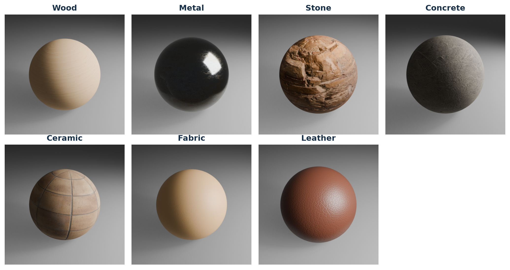

One actual holdout image per class, chosen by sorted path before considering prediction correctness. This descriptive gallery is not a random sample; exact IDs and image hashes are in gallery_selection.json.

Ceramic in the historical corpus includes mosaic and terrazzo-like assets; concrete includes plaster and painted-wall appearances. The fresh collection uses restricted ceramic/concrete definitions. These labels are appearance categories, not laboratory measurements of composition. Coatings, rust and suede-like appearances can blur category boundaries.

## 3. Source audit and independence

All 316 original local source maps were verified against official provider records: 315 manifest-referenced maps plus one additional displacement map. The fresh collection adds 63 verified maps. Poly Haven verification compares official metadata MD5 and file size with local files, with local SHA-256 pinning; ambientCG verification compares SHA-256 and size against official archive members. These are different verification mechanisms and are not represented as remote SHA-256 matches in every case.

Provider assets are CC0 [6,7]. The project authors the rendered images and experimental code; it does not claim authorship of third-party texture maps. Individual attribution and provider URLs remain in the source registries. License verification establishes source permissions within that evidence scope; it does not prove independent physical ancestry.

The original registry merges known leather-generator families and a conservative wood relationship, yielding 101 groups from 105 IDs. Fresh selection checks original IDs, aliases, normalized-name families, procedural ancestry, official recipe/map identities and exact raw map reuse. No known overlap remains between development and holdout. Undisclosed captures, crops or recolours may still share physical ancestry.

## Rendering and domain differences

Blender EEVEE renders a textured sphere with controlled camera, light and ground. A seven-image old-training pilot checked the fresh Blender 5.1.1 setup before bulk rendering. Framing and placement matched visually, but ground shadows were softer. The historical engine version was not fully recorded, so engine equivalence is not claimed. Restricted class semantics and rendering changes jointly limit direct transport of development estimates.

## Local study package

The validated audit ZIP contains all 3,780 images and compact provenance records. Private Windows paths embedded in PNG metadata were removed from package copies while decoded pixels were verified identical. Package byte hashes therefore differ from canonical source byte hashes; both are retained. Raw textures, scene binaries and model weights are excluded. The rendered-dataset license remains unset, release approval is false and nothing has been uploaded. Appendix A identifies the archive.

## 4. Fixed protocol and amendments

All 3,150 original images are development data in V3. Historical train, validation and test directories remain lineage records; the old test had already been consulted. Known relatives crossing those old partitions are grouped together for V3. None of the original images is relabelled as a new untouched test.

The frozen experiment uses five class-stratified outer source-group folds and three grouped inner folds, seed 20261027. Every image follows its source group. Inner selection maximizes mean Macro F1 across five declared representations and C in {0.01, 0.1, 1, 10}. Ties use declaration order, then ascending C. Scaling and fitting occur inside each training partition; outer labels never choose the representation or regularization.

The matched ConvNeXt control selects C independently on the same partitions. ResNet-50 was declared before V3 scores and uses a fixed ten-epoch schedule on those identical outer folds, without outer-validation checkpoint selection. The initial frozen result was 79.40%, below the point target.

After that initial result, a bounded exploratory DINOv2 follow-up compared two learning rates across the same three all-development selection folds. Its development score is explicitly adaptive and is not a replacement nested estimate. The original experiment is preserved.

The final primary choice used development Macro F1: 0.8035245993 for frozen fusion versus 0.7724822183 for fine-tuned DINOv2. All final checkpoints were locked at 09:51:05 UTC on 27 October 2026, before first fresh prediction at 09:54:06 UTC. The four fixed models each received one clean evaluation. No fresh ranking changed model choice.

Primary corruption tests were predeclared. The identical five corruptions were later applied to fine-tuned DINOv2 after clean scores and primary corruption outcomes had been observed. A recorded amendment labels this additional robustness comparison post hoc and exploratory. No model or clean prediction changed.

## Uncertainty

Accuracy and Macro F1 are image-weighted. Confidence intervals use 10,000 class-stratified source-group cluster bootstrap draws, seed 62642, with percentile 95% limits. Each sampled group brings all its images with multiplicity. Paired differences use matching images and source draws. Intervals condition on saved predictions; they do not include refitting, selection uncertainty or dependent cross-validation training sets. Only three new groups per class constrain uncertainty resolution.

## 5. Pipelines and compute-budget confounds

Model definitions from frozen configurations and checkpoint metadata. Exact weight identities are in the evidence bundle.

| Pipeline | Representation / input | Adaptation and budget |
| --- | --- | --- |
| Primary frozen fusion | DINOv2 small with registers, 224 + 336; ConvNeXt-Tiny, 224 | 3,072 features; scaled balanced logistic head; inner C selection |
| ConvNeXt control | Pooled ConvNeXt-Tiny, 224 | Frozen backbone; independently selected logistic C |
| Fixed ResNet-50 | ImageNet-1K V2 weights, 224 | Two head-only epochs, then layer4 + head; ten fixed epochs |
| Fine-tuned DINOv2 | Small with registers; CLS + patch mean, 336 | Two head-only epochs, then last two blocks; six development fits, five-epoch final fit |

The primary vector concatenates CLS, patch mean and patch population standard deviation for DINOv2 at 224 and 336 pixels, then adds pooled ConvNeXt features. Registers are not patches. StandardScaler and a class-balanced L2 logistic regression head use lbfgs, tolerance 0.0001 and up to 3,000 iterations. A convergence warning fails the run rather than silently changing the solver.

Frozen feature extraction is deterministic and learns no dataset-specific representation. Cached features can be shared across grouped folds, while the scaler and classifier must be refitted within each training fold. The canonical caches and final frozen run exactly reproduce the earlier feature arrays and OOF prediction files.

ResNet uses AdamW, head learning rate 0.0003 and layer4 learning rate 0.00001, weight decay 0.01, label smoothing 0.05 and a fixed cosine schedule. Batch-normalization running statistics stay frozen. Its ten-epoch final fit uses all development images and does not consult fresh labels.

DINOv2 adaptation searches backbone learning rates 3e-6 and 1e-5 with a maximum of ten epochs and development patience three. Best epochs at 1e-5 are 6, 5 and 3; their rounded median yields five epochs for the all-development fit. This stage follows the initial result and must retain its exploratory label.

The pipelines differ in pretraining corpora and objectives, input resolution, feature dimension, number of backbone passes, search budget and amount of adaptation. Their measured differences compare complete workflows. They cannot isolate a transformer-versus-CNN effect, the benefit of self-supervision alone or equal-compute efficiency. No audit establishes the absence of public texture overlap in backbone pretraining data.

## 6. Actual development learning curves

The six completed DINOv2 fits below show actual recorded epochs. Solid lines are training measurements; dashed lines are development validation. Training Macro F1 approaches one while validation varies substantially by source fold. This gap supports cautious interpretation of adaptation on a small family-diverse corpus.

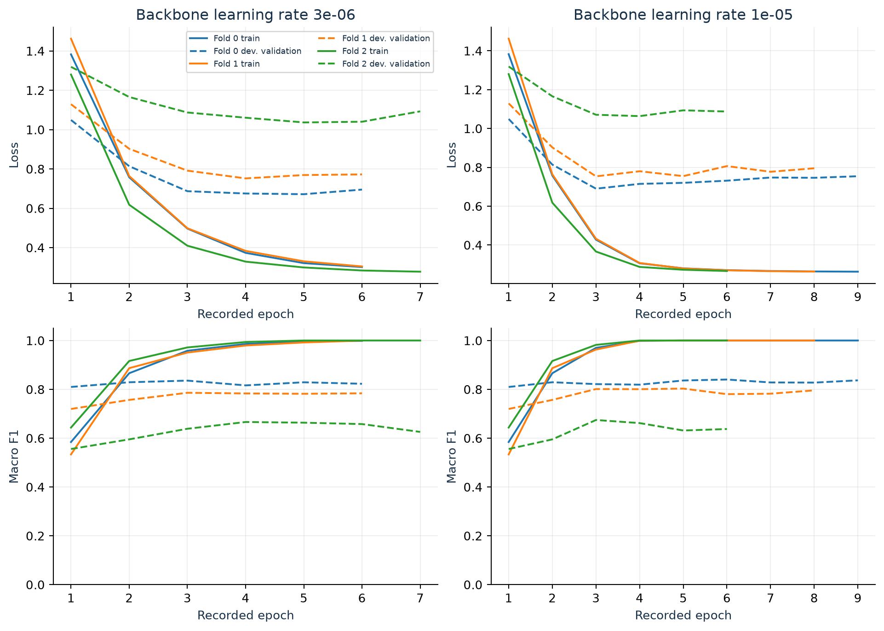

All six development histories; no smoothing, interpolation or invented epochs. Validation is used for epoch and learning-rate selection and is not an independent test. Source: finetune_development/lr_*/progress.json.

The selected learning rate, 1e-5, has mean best-fold development Macro F1 0.77248; 3e-6 yields 0.76250. Both are below the frozen selector reference 0.80352. Early stopping shortens some histories. No fresh-set learning curve exists because the holdout was evaluated only after fitting.

## 7. Fixed baseline training and frozen selection

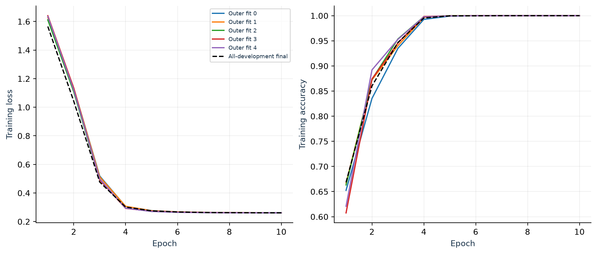

Actual ResNet-50 training histories for all five outer fits and the final all-development fit. No epoch-wise validation was used or logged for this fixed schedule; the curves must not be interpreted as validation performance.

All six ResNet fits complete the prescribed ten epochs. The rapid increase in training accuracy does not establish generalization: the matched existing-corpus OOF accuracy is 71.56%, and the fresh result is 77.62%. Final-epoch evaluation respects the predeclared baseline even when intermediate training performance appears strong.

The frozen logistic model has no neural epoch history. Its appropriate selection diagnostic is Macro F1 versus inverse regularization C, calculated from the actual grouped inner-fold search. Appendix B preserves this curve and the candidate table; fabricating a logistic epoch curve would misrepresent the method.

Measured neural execution records contain 6,072.20 seconds across successful stages, with stage boundaries and environment recorded. This is not a controlled total cost comparison with frozen feature extraction: cache preparation, different selection searches and distinct model budgets have different scopes. No GPU work was launched during report production.

Implementation and configuration hashes, fold assignments and final checkpoint identities accompany the histories. The final full-data fit is a deployment operation, not another performance estimate.

## 8. Initial results and historical context

Matched five-fold existing-corpus OOF results: 3,150 images, 101 source families. Frozen selection uses nested tuning; ResNet is a fixed baseline.

| Existing-corpus procedure | Accuracy | Macro F1 |
| --- | --- | --- |
| Frozen selection | 79.40% | 0.7955 |
| ConvNeXt control | 68.86% | 0.6861 |
| Fixed ResNet-50 | 71.56% | 0.7135 |

The initial primary selection procedure achieved 79.40% accuracy (95% CI 72.65-85.57%) and Macro F1 0.7955. It did not meet the 80% point target. Paired accuracy differences were +10.54 percentage points versus the control (95% CI 4.83-16.45) and +7.84 versus fixed ResNet (1.46-14.14). These conditional fixed-prediction intervals exclude zero on this development population; they do not establish the corresponding fresh-population effects.

Historical V1 test results, retained verbatim in model_comparison.csv and displayed with rounding. A separate, previously consulted endpoint.

| Historical V1 model | Test accuracy | Test Macro F1 |
| --- | --- | --- |
| custom_cnn | 49.76% | 0.4902 |
| resnet50 | 69.76% | 0.6829 |
| convnext_tiny | 61.19% | 0.5690 |
| vit_b16 | 60.00% | 0.5624 |

V1 used different partitions, models and selection histories. Known family relationships crossed historical splits, and the old test was consulted. This table documents project history only. Differences between V1, nested V3 and fresh V3 are not direct improvement estimates, and none of these endpoints is pooled.

The fresh primary result of 80.16% belongs to a different, restricted source population. Its small numerical increase over 79.40% is not evidence of a statistically established generalization improvement.

## 9. Clean fresh-source assessment

All four model artifacts were fixed before these 630 predictions. Each class contributes 90 images from three groups.

| Pipeline / role | Accuracy | 95% accuracy CI | Macro F1 |
| --- | --- | --- | --- |
| Primary frozen fusion | 80.16% | 66.03-93.65% | 0.7952 |
| ConvNeXt control | 75.56% | 61.59-88.73% | 0.7566 |
| Fixed ResNet-50 | 77.62% | 63.65-90.48% | 0.7665 |
| Fine-tuned DINOv2 | 86.83% | 76.98-95.87% | 0.8631 |

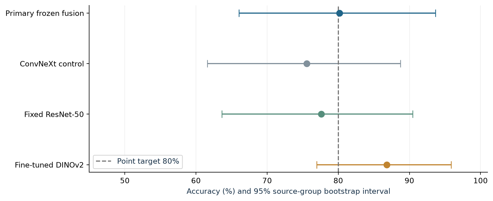

Accuracy uncertainty is resampled over source groups, not independent images. The primary remains frozen fusion; the final row is an exploratory comparison.

The primary gets 505 of 630 images correct. Fine-tuned DINOv2 gets 547 correct and has the highest observed comparison accuracy. The control and fixed baseline remain below the target. The primary point estimate meets 80%, while its 66.03% lower bound and the corruption results prevent a broad guarantee.

With only 21 source groups, seemingly large point differences can remain uncertain. Inspecting the paired intervals is more appropriate than deciding superiority from ranked point estimates or overlap of marginal confidence intervals alone.

## 10. Primary class-level errors

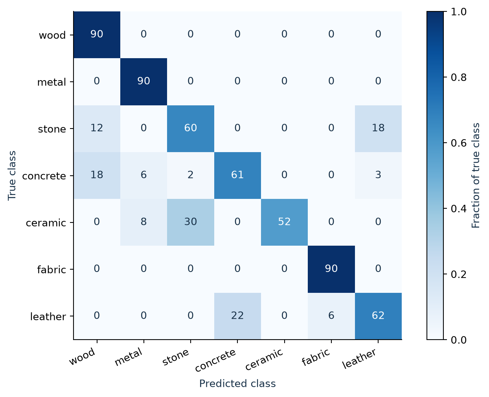

Primary clean confusion matrix. Cells show image counts; colour is row-normalized. Every true class has 90 images.

Per-class point metrics from the saved primary evaluator output. Views within each source are correlated.

| Class | Support | Precision | Recall | F1 |
| --- | --- | --- | --- | --- |
| wood | 90 | 0.750 | 1.000 | 0.857 |
| metal | 90 | 0.865 | 1.000 | 0.928 |
| stone | 90 | 0.652 | 0.667 | 0.659 |
| concrete | 90 | 0.735 | 0.678 | 0.705 |
| ceramic | 90 | 1.000 | 0.578 | 0.732 |
| fabric | 90 | 0.938 | 1.000 | 0.968 |
| leather | 90 | 0.747 | 0.689 | 0.717 |

Wood, metal and fabric each have perfect recall on these three sampled sources per class. This is not evidence of perfect population recall. Ceramic has the lowest recall (57.78%); stone, concrete and leather are also difficult. A high ceramic precision of 1.000 coexists with missed ceramic examples, demonstrating why precision and recall must be reported together.

## 11. Comparison errors and paired uncertainty

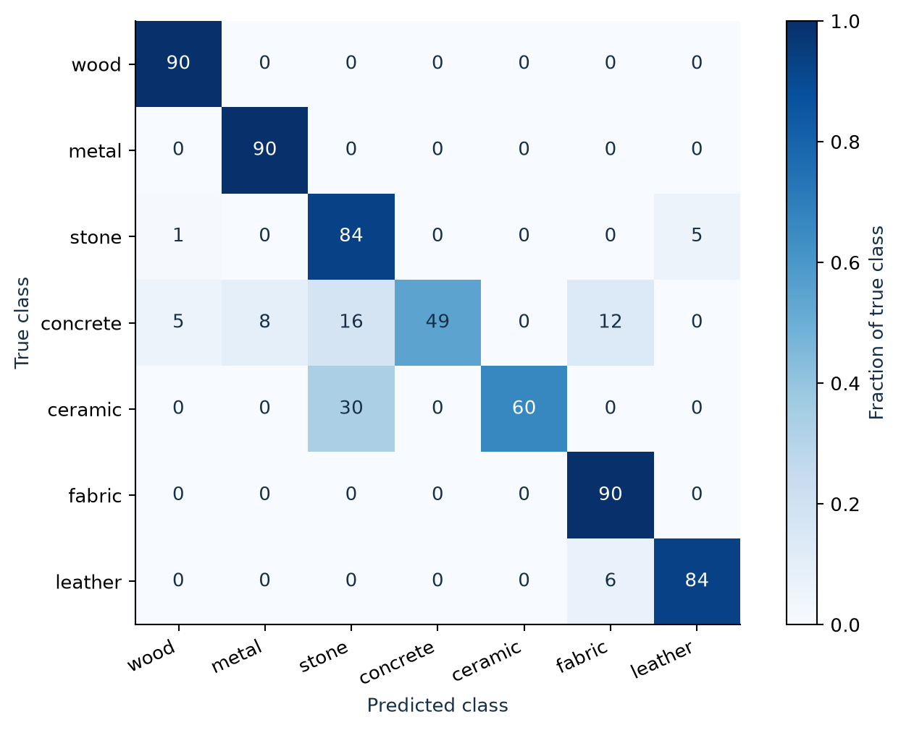

Exploratory fine-tuned DINOv2 clean confusion matrix on the identical holdout. Counts and row-normalized colour use the same scale as the primary.

Saved paired source-group bootstrap results. All three accuracy intervals include zero; pp means percentage points.

| Paired accuracy difference | Estimate (pp) | 95% CI (pp) |
| --- | --- | --- |
| Primary - control | +4.60 | -3.17 to +12.70 |
| Primary - ResNet | +2.54 | -2.54 to +7.78 |
| DINOv2 - primary | +6.67 | -2.06 to +16.19 |

DINOv2 improves observed stone recall to 93.33% and leather recall to 93.33%, but concrete recall falls to 54.44% from the primary 67.78%. A better aggregate point score therefore does not improve every class. Its higher clean score does not justify changing the primary after the test.

## 12. Calibration and selective prediction

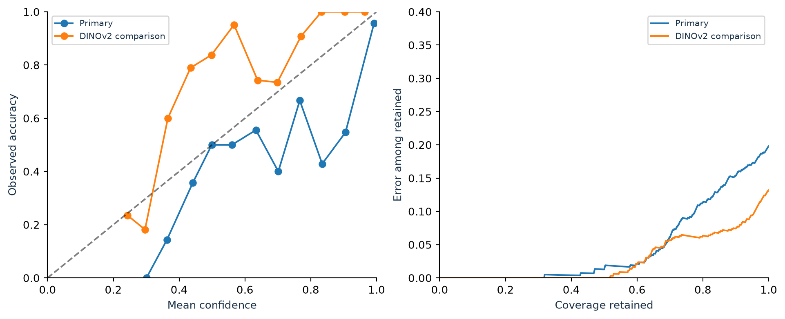

Saved reliability bins and confidence-ranked risk/coverage curves. The dashed diagonal represents perfect calibration. Curves describe this holdout and are not deployment-threshold validation.

Lower is better for these probability metrics. Brier score sums squared class-probability errors; ECE uses 15 equal-width confidence bins.

| Pipeline | Log loss | Brier score | ECE (15 bins) |
| --- | --- | --- | --- |
| Primary frozen fusion | 0.6745 | 0.3018 | 0.0948 |
| ConvNeXt control | 0.8611 | 0.3543 | 0.0847 |
| Fixed ResNet-50 | 0.7097 | 0.3075 | 0.1050 |
| Fine-tuned DINOv2 | 0.5234 | 0.2310 | 0.1411 |

DINOv2 has better observed log loss and Brier score, but higher ECE (0.1411 versus 0.0948 for the primary). Accuracy ranking and calibration ranking therefore differ. Sparse bins and a few correlated families limit the stability of calibration estimates.

Abstention can retain high-confidence predictions and reduce observed error at the cost of coverage. The risk curve shows this tradeoff after observing the holdout; it does not authorize a chosen threshold for unseen inputs. No temperature scaling, calibration fit or threshold selection was performed on the fresh set. Deployment thresholds would require separate development validation and a new assessment.

Macro F1 gives equal weight to the seven fixed class F1 values. Balanced accuracy averages observed-class recall. MCC and Cohen kappa complement the main metrics; complete scalar intervals are retained in Appendix C and evaluator JSONs. Undefined metrics remain explicit rather than being replaced with favourable defaults.

## 13. Inspecting failure families

The gallery shows high-confidence mistakes from distinct failing source groups. Selection sorts wrong predictions by confidence, breaks ties by image path and keeps at most one view per group. It intentionally exposes difficult cases; it is not a random sample or an estimate of failure prevalence.

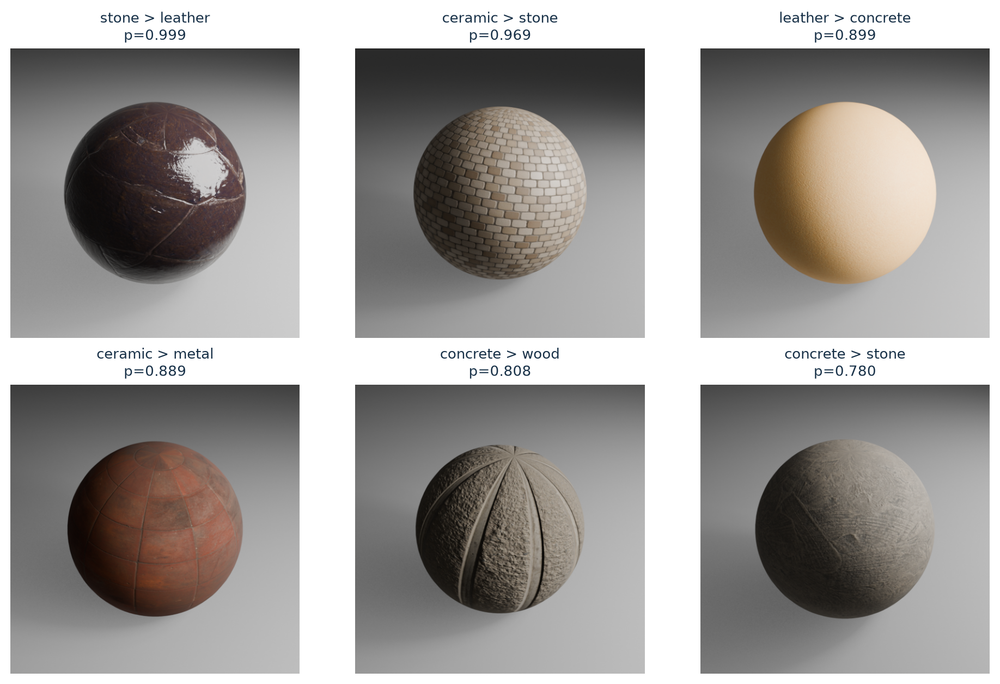

Actual primary holdout errors. Labels read true class > predicted class; p is the largest saved class probability. Exact image IDs, group IDs and source image hashes are preserved in gallery_selection.json. No inference was rerun.

Texture and reflectance can resemble another archival category even when the source label is unchanged. Several views of a misclassified source can share the same appearance cue, so counting each as an independent failure would overstate the evidence. Conversely, correct views from one family do not establish transfer to all materials in that class.

These examples motivate collecting more independently sourced borderline categories and testing different scenes. They do not establish the causal image feature used by the classifier. No attention map or saliency explanation is claimed, and no difficult source was removed or relabelled after seeing predictions.

## 14. Robustness and compression failure

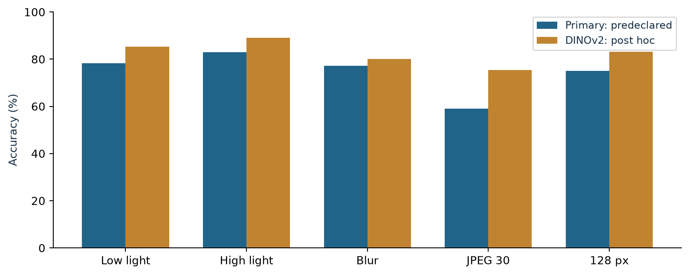

The same 630 source images under each fixed corruption. Primary tests were predeclared; DINOv2 tests were added after clean and primary-corruption scores.

Measured corruption accuracies. These are five deterministic transformations, not five independent new datasets.

| Condition | Primary accuracy | DINOv2 accuracy |
| --- | --- | --- |
| Low brightness | 78.25% | 85.24% |
| High brightness | 83.02% | 89.05% |
| Gaussian blur | 77.14% | 80.00% |
| JPEG quality 30 | 59.05% | 75.40% |
| Resolution 128 | 75.08% | 83.17% |

JPEG quality 30 is the largest observed degradation: primary accuracy loses 21.11 percentage points, reaching 59.05%, and Macro F1 falls to 0.5749. Blur and reduced resolution also lower accuracy. Increased brightness improves the observed primary score to 83.02%; this is a property of this fixed collection, not evidence that brighter inputs generally help.

Post hoc DINOv2 robustness remains explicitly exploratory. It reaches 75.40% on JPEG quality 30, still below its clean 86.83% and below the point target. Its higher corruption point scores do not change primary choice or establish statistically confirmed robustness superiority. No new model fitting occurred.

These transforms test sensitivity to encoded-image changes. They do not cover new physical materials, new scene geometry, sensor noise, arbitrary cameras or real photographs. The complete per-class recall changes, including improvements and degradations, remain in the evidence bundle.

## 15. Measured deployment cost

Same CUDA system and benchmark inputs, four CPU threads. Decimal bytes; MB in the chart equals 1,000,000 bytes.

| Pipeline | Batch 1 median ms | Batch 16 images/s | Deployment bytes |
| --- | --- | --- | --- |
| Primary frozen fusion | 42.876 | 46.361 | 203,629,625 |
| ConvNeXt control | 14.205 | 174.416 | 115,271,775 |
| Fixed ResNet-50 | 9.463 | 294.688 | 95,315,284 |
| Fine-tuned DINOv2 | 13.862 | 101.438 | 88,027,439 |

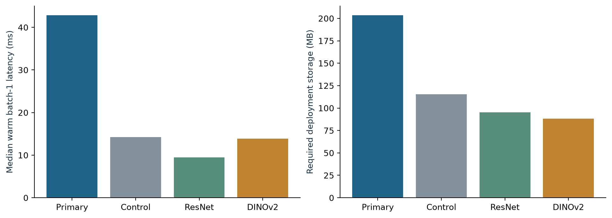

Warm latency and complete required deployment storage. The 311 KB primary classifier file alone is not the model deployment size.

Warm timing starts from predecoded RGB and includes preprocessing, model computation and probabilities. Disk image I/O and decoding are excluded. Batch-one median and batch-16 throughput answer different questions. Measurements were made on an NVIDIA GeForce RTX 4070 Laptop GPU with approximately 8 GB VRAM, Windows 11, Python 3.13.5 and CUDA runtime 12.8.

The primary requires multiple backbone passes and has the largest complete storage footprint. ResNet is fastest in this benchmark. The fine-tuned DINOv2 checkpoint contains standalone weights and does not require a pretrained cache dependency for loading. The frozen pipelines require their pinned pretrained files as well as the head and sidecar.

Reload measurements in the underlying benchmark are process-warm model reloads, not fresh-process or OS-cold startup. CUDA memory values are process allocator peaks, not total board usage. Results are specific to the recorded hardware, software, batch size and timing scope; no FLOPs or cross-device speed claim is made.

## 16. Limitations, conclusion and next steps

## What the evidence supports

The preselected primary achieved the requested 80% point target on a clean, independently collected source holdout. This is a completed measured result: 80.16% accuracy and Macro F1 0.7952. The highest observed comparison is fine-tuned DINOv2 at 86.83%, but paired uncertainty does not establish its superiority and its exploratory status remains unchanged.

## What remains unresolved

Only three new families per class constrain inference. Thirty views per material are dependent, known-family grouping is conservative and physical ancestry is incomplete. Public texture overlap with backbone pretraining data has not been audited. Restricted class semantics and Blender-version differences complicate transfer from the original corpus. No real-world validation exists.

Compression is a major practical limitation. The primary misses the target on low brightness, blur, JPEG compression and reduced resolution. Per-class performance is uneven, with ceramic, concrete, stone and leather exposing boundary problems. Perfect sampled recall for some classes is not a population guarantee. Calibration and abstention diagnostics are descriptive and do not validate an operating threshold.

Model comparisons confound architecture, pretraining, resolution, adaptation and compute budgets. The bounded DINOv2 follow-up was motivated by the initial outcome; later robustness was post hoc. The historical test was previously consulted. All these decisions are disclosed rather than presented as one fully preregistered experiment.

## Recommended next experiment

Freeze a new evaluation plan before gathering or scoring additional sources. Priorities are more independently verified families in ambiguous categories, held-out scenes and genuine photographs, stronger compression coverage and development-only threshold calibration. Budget-matched ablations would better separate representation effects from extra passes or adaptation. Any subsequent tuning on this now-scored holdout requires a new independent assessment.

The final artifacts support research, teaching and inspection of comparable synthetic renders. They do not identify physical composition or justify safety-critical material decisions. Dataset publication remains a separate owner decision; the complete audit package is prepared locally with no upload.

## References

[1] Oquab et al. (2024). DINOv2: Learning Robust Visual Features without Supervision. https://arxiv.org/abs/2304.07193

[2] Darcet et al. (2024). Vision Transformers Need Registers. https://arxiv.org/abs/2309.16588

[3] Liu et al. (2022). A ConvNet for the 2020s. https://arxiv.org/abs/2201.03545

[4] He et al. (2016). Deep Residual Learning for Image Recognition. https://arxiv.org/abs/1512.03385

[5] Cawley and Talbot (2010). On Over-fitting in Model Selection and Subsequent Selection Bias in Performance Evaluation. JMLR 11:2079-2107. https://jmlr.org/papers/v11/cawley10a.html

[6] Poly Haven. Asset License (CC0). https://polyhaven.com/license

[7] ambientCG. License (CC0). https://docs.ambientcg.com/license/

Research and provider references were checked on 27 October 2026. Experiment-specific claims derive from the saved local evidence identified in the appendices, not from these external publications.

## Appendix A. Reproduction and evidence map

Canonical primary checkpoint: artifacts/v3/run_final/model.joblib with model_metadata.json. Control: artifacts/v3/run_final/control_model.joblib. ResNet: artifacts/v3/resnet-final/final/model.pt. Exploratory DINOv2: artifacts/v3/finetune/candidates/finetuned/model.pt. Exact hashes are pinned by reports/results/v3/final_model_lock.json; weight files are referenced, not copied into the report bundle.

The assembly specification is reports/results/v3/report_inputs/assembly.json. The validated bundle is reports/results/v3/report_evidence_final; report_manifest.json hashes its evidence files. derived/source_inventory.json maps every copied source to its original SHA-256, normalized-copy SHA-256 and role. Text copies use UTF-8 without BOM and LF before hashing. Original files remain unchanged.

Core result sources: reports/results/v3/fresh/<model>/evaluation.json and predictions.csv; nested_selected, nested_control and nested_resnet/evaluation.json; fresh/paired_*.json; robustness/{primary,dinov2_exploratory}/*.csv; benchmarks/<model>/benchmark.json. Neural histories reside in finetune_development and resnet_baseline. The code commit pinned by the final model lock is 6e8b31125f2c2b6a39358a4ccc70270095e5b9d8. Report editorial code is independently versioned.

The executed companion notebook is notebooks/05_v3_results.ipynb. It contains 30 cells, 16 code cells and 11 plots, with 61 evidence/hash/identity/metric assertions reported passing by the notebook build. It reads saved results and performs no training or inference.

Rebuild into new directories from the project environment:
python scripts/v3/assemble_report.py --spec reports/results/v3/report_inputs/assembly.json --output-dir reports/results/v3/report_evidence_rebuild
python scripts/v3/build_report.py --results-dir reports/results/v3/report_evidence_rebuild --output-dir reports/v3_rebuild
python -m pytest tests/test_v3_report.py tests/test_v3_report_assembly.py -q

Local audit ZIP: artifacts/v3/release-staging/material-classification-v3-study-audit.zip
Size: 1,005,048,843 bytes
SHA-256: 4f2bd057d66493ada1cc4b9d69d7932bcdfcb52798cb5aaf6f2887442a58d1da
The companion validation sidecar verifies all entries, manifests and decoded pixels. Dataset license unset; release_approved=false; no upload.

The historical root report.pdf and report.docx are preserved. Model weights and raw datasets remain outside Git. Internal page-render QA is stored separately from publication artifacts.

## Appendix B. Frozen selection diagnostics

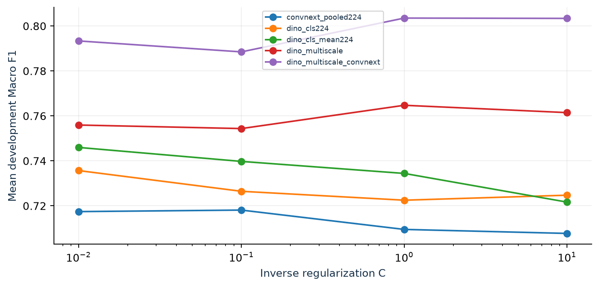

Actual all-development three-fold inner selection scores, not fresh test or epoch learning curves. Source: canonical search_history.csv.

Predeclared candidate existing-corpus OOF summaries; C is inner-selected. Descriptive candidates do not replace the selection-procedure estimate.

| Candidate | Accuracy (%) | Macro F1 | Log loss (nats) |
| --- | --- | --- | --- |
| dino_cls224 | 78.349 | 0.7847 | 0.6956 |
| dino_cls_mean224 | 78.540 | 0.7868 | 0.6987 |
| dino_multiscale | 79.810 | 0.7982 | 0.8388 |
| convnext_pooled224 | 68.857 | 0.6861 | 1.0603 |
| dino_multiscale_convnext | 79.841 | 0.7991 | 0.7719 |

The all-development selection chose dino_multiscale_convnext at C=1. Outer folds can choose different recipes, so the nested score estimates the full procedure rather than one universally fixed recipe. The preserved fold choices, per-fold summaries, search histories and candidate predictions permit exact inspection.

## Appendix C. Scalar metrics and interpretation

Primary clean holdout. Scores are fractions except dimensionless loss metrics; all intervals use the recorded fixed-prediction source-group bootstrap.

| Metric | Estimate | 95% source-group CI |
| --- | --- | --- |
| Accuracy | 0.8016 | 0.6603 to 0.9365 |
| Balanced Accuracy | 0.8016 | 0.6603 to 0.9365 |
| Macro Precision | 0.8124 | 0.6293 to 0.9477 |
| Macro Recall | 0.8016 | 0.6603 to 0.9365 |
| Macro F1 | 0.7952 | 0.6172 to 0.9345 |
| Weighted F1 | 0.7952 | 0.6172 to 0.9345 |
| MCC | 0.7716 | 0.6121 to 0.9294 |
| Cohen Kappa | 0.7685 | 0.6037 to 0.9259 |
| Log Loss | 0.6745 | 0.1991 to 1.2305 |
| Brier Score | 0.3018 | 0.1071 to 0.5160 |
| ECE | 0.0948 | 0.0313 to 0.2126 |

Accuracy is correct predictions divided by images. Macro precision, recall and F1 average over the seven fixed classes. Weighted F1 uses class support; on this balanced holdout it equals Macro F1. Brier score is the mean summed squared class-probability error; log loss clips probabilities according to evaluator conventions. ECE aggregates absolute confidence/accuracy gaps across 15 equal-width bins.

Each source contributes exactly 30 images on the fresh endpoint, so image-weighted and source-balanced accuracy coincide numerically. Source-balanced accuracy is an average of within-source accuracies, not multiview voting. Group-level mean-probability predictions are separate secondary diagnostics and must not replace the primary image endpoint.

These pooled scalar intervals are not per-class confidence intervals. Per-class support and point metrics are shown in Section 10 and the saved evaluator outputs. Only three source groups per class limit class-level precision; no additional interval has been estimated during report production.

The bound at 80% is an engineering point target, not a hypothesis-test threshold or a guaranteed lower confidence limit. Retaining all outcomes, explicit population definitions and source hashes is essential to interpreting the result.
